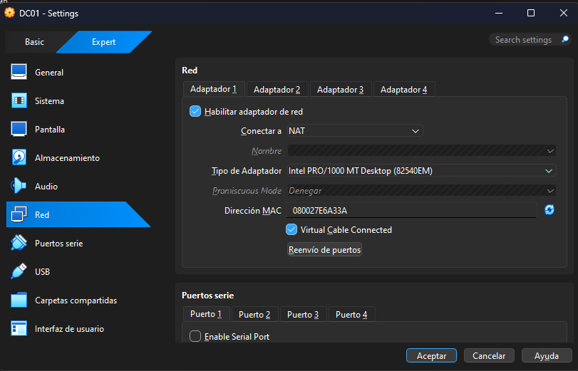
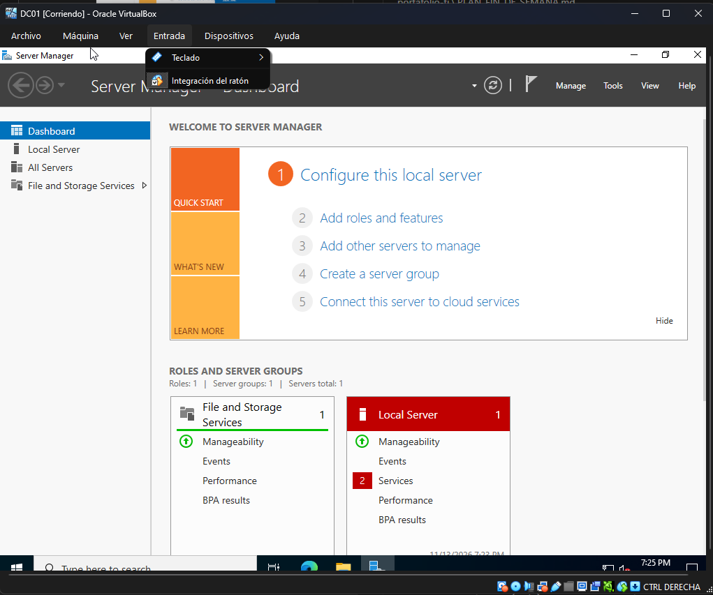
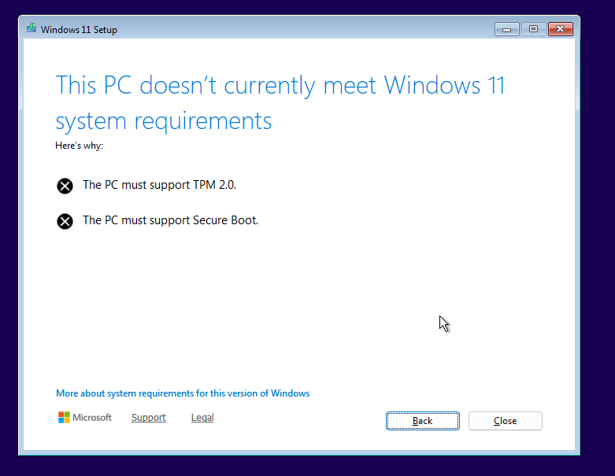
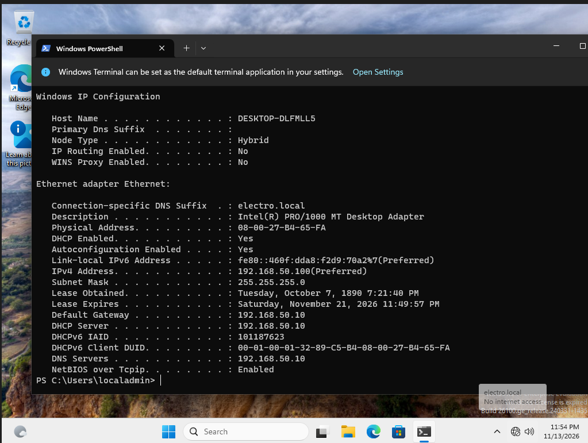
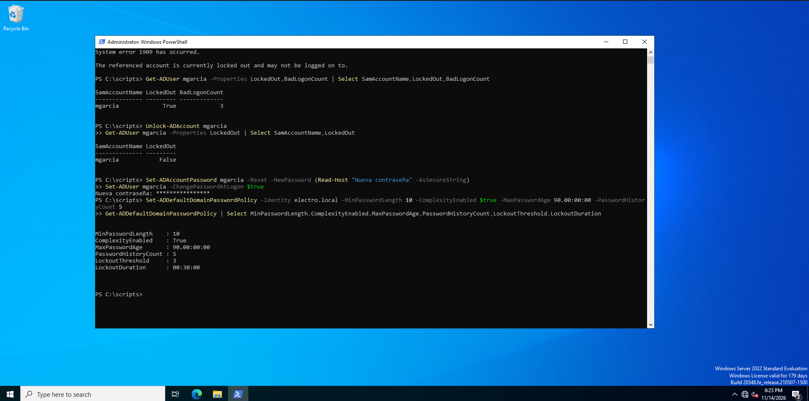
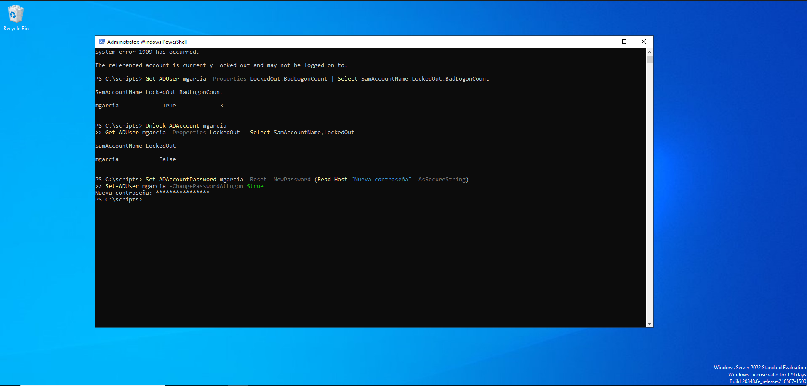

# Cómo armé el laboratorio de Active Directory

🇺🇸 [English version](GUIDE.md)

Dominio: `electro.local` · Servidor: `DC01` (192.168.50.10) · Cliente: `PC01`

Son mis notas de cómo armé el lab, en el orden en que fui haciendo las cosas y con los comandos que ejecuté. Los problemas que me salieron en el camino están en el [README](README.es.md).

## Antes de empezar: red y máquinas virtuales

Hice dos VMs en VirtualBox:

| VM | Adaptador 1 | Adaptador 2 | Recursos |
|---|---|---|---|
| DC01 (Windows Server 2022) | NAT (internet) | Red interna `labnet` | 4 GB RAM, 2 CPU, 50 GB |
| PC01 (Windows 11 Enterprise) | Red interna `labnet` | no tiene | 4 GB RAM, 2 CPU, 60 GB |

La red interna es donde vive el dominio. DC01 tiene además un adaptador NAT para que el servidor tenga internet. PC01 solo ve `labnet`.

En PC01 usé firmware BIOS y el TPM en "ninguno", porque con EFI la VM se quedaba con la pantalla negra. Con 16 GB de RAM en mi PC las dos VMs corren a la vez sin problema.


*DC01, adaptador 1: NAT (internet)*

*DC01, adaptador 2: red interna `labnet`*

### Cómo pasé los scripts a las VMs
Activé el portapapeles compartido (Dispositivos → Portapapeles compartido → Bidireccional), copié el archivo en mi PC y lo pegué dentro de la VM con:

```powershell
Get-Clipboard | Set-Content C:\scripts\nombre.ps1 -Encoding UTF8
```

Cuando guardé archivos con el Bloc de notas tuve que elegir "Todos los archivos" como tipo, o se quedaban como `.txt`. También tuve que abrir PowerShell con "Ejecutar como administrador" desde el menú Inicio, porque el de Windows Terminal me daba un error.

## 1. Instalar Windows Server 2022
1. Nueva VM, tipo Windows 2022, ISO de evaluación.
2. Elegí **Standard Evaluation (Desktop Experience)**. Sin Desktop Experience no hay interfaz gráfica.
3. Puse una contraseña de Administrator solo para el lab (no está en el repositorio).
4. Instalé Guest Additions desde el menú Dispositivos y reinicié.


*Server Manager en el Windows Server 2022 recién instalado*

## 2. Promover a controlador de dominio
En PowerShell como administrador en DC01 primero revisé cómo se llaman los adaptadores:

```powershell
Get-NetAdapter
```

Luego ejecuté [scripts/01-Setup-DC.ps1](scripts/01-Setup-DC.ps1), después de poner en `$LabAdapter` el adaptador de la red interna (`Ethernet 2` en mi caso). El script trabaja por fases y reinicia el servidor dos veces. Mi primer intento falló porque la contraseña DSRM no cumplía la complejidad, así que volví a ejecutar `Install-ADDSForest` con una más fuerte.

Para comprobar el resultado:
```powershell
Get-ADDomain
Get-Service NTDS, DNS, Netlogon
dcdiag /q
```


*`Get-ADDomain` después de la promoción*

### Limpiar el DNS (servidor con dos tarjetas)
Como DC01 tiene la tarjeta NAT, registró también esas IPs (`10.0.2.15` y una IPv6) en el DNS, y los clientes recibían direcciones que no servían. Evité que el adaptador NAT se registrara y borré el registro que ya se había creado:

```powershell
Set-DnsClient -InterfaceAlias "Ethernet" -RegisterThisConnectionsAddress $false
Remove-DnsServerResourceRecord -ZoneName electro.local -Name "dc01" -RRType A -RecordData 10.0.2.15 -Force
```
Desde un cliente, `nslookup electro.local` debe devolver solo `192.168.50.10`.

## 3. DHCP
Ejecuté [scripts/02-Setup-DHCP.ps1](scripts/02-Setup-DHCP.ps1) en DC01. Crea el ámbito `LAN-Lab` (192.168.50.100 a 200) con DNS, dominio y puerta de enlace apuntando a DC01.


*Ámbito DHCP `LAN-Lab` activo en DC01*

## 4. Cliente Windows 11 y unión al dominio
1. Creé la VM PC01 con un solo adaptador en `labnet`.
2. El instalador de Windows 11 decía "This PC doesn't meet the system requirements" porque la VM no tiene TPM ni Secure Boot. Pulsé Shift+F10 y en la consola ejecuté:
   ```cmd
   reg add HKLM\SYSTEM\Setup\LabConfig /v BypassTPMCheck /t REG_DWORD /d 1 /f
   reg add HKLM\SYSTEM\Setup\LabConfig /v BypassSecureBootCheck /t REG_DWORD /d 1 /f
   exit
   ```
   Después regresé un paso en el instalador y continué.
3. Creé una cuenta local (`localadmin`). Con Windows ya instalado comprobé que PC01 recibió su IP por DHCP:
   ```powershell
   ipconfig /all        # IP 192.168.50.1xx, DNS 192.168.50.10
   nslookup electro.local
   ```
4. Me uní al dominio desde PowerShell **como administrador** (la primera vez se me olvidó y salió "Access is denied"):
   ```powershell
   Add-Computer -DomainName electro.local -Credential electro\administrator -Restart
   ```
5. Después del reinicio entré como `administrator@electro.local`.

Para escribir cuentas de dominio uso `usuario@electro.local`, así no dependo de la tecla `\`, que está en otro lugar según el idioma del teclado. Si falla la unión, reviso primero el DNS: el cliente tiene que usar `192.168.50.10`.


*El instalador de Windows 11 bloqueando por TPM y Secure Boot*

*PC01 con IP del ámbito DHCP y DC01 como DNS*

*PC01 unida a `electro.local`*

## 5. OUs, grupos y usuarios en lote
Copié `03-New-BulkUsers.ps1` y `users.csv` a `C:\scripts` en DC01 y ejecuté:

```powershell
cd C:\scripts
Set-ExecutionPolicy -Scope Process Bypass -Force
.\03-New-BulkUsers.ps1 -WhatIf     # simula, no crea nada
.\03-New-BulkUsers.ps1             # real; pide la contraseña inicial
```

La contraseña inicial tiene que cumplir la política del dominio, y cada usuario debe cambiarla en su primer inicio de sesión. Para comprobar:
```powershell
Get-ADOrganizationalUnit -Filter * -SearchBase "OU=Empresa,DC=electro,DC=local" | Select Name
Get-ADGroup -Filter "Name -like 'GG_*'" | Select Name
Get-ADUser -Filter * -SearchBase "OU=Empresa,DC=electro,DC=local" | Select Name, SamAccountName, Enabled
```
Me salieron 7 OUs (Empresa, Grupos y los 5 departamentos), 5 grupos `GG_*` y 10 usuarios.


*OUs, grupos `GG_*` y los 10 usuarios creados por el script*

## 6. Tareas de Help Desk

### 6.1 Política de contraseñas y bloqueo (nivel dominio)
```powershell
Set-ADDefaultDomainPasswordPolicy -Identity electro.local `
  -MinPasswordLength 10 -ComplexityEnabled $true `
  -MaxPasswordAge 90.00:00:00 -PasswordHistoryCount 5 `
  -LockoutThreshold 3 -LockoutDuration 00:30:00 -LockoutObservationWindow 00:30:00
Get-ADDefaultDomainPasswordPolicy
```
Este tipo de política solo aplica a nivel dominio. Una GPO normal vinculada a una OU no la puede poner.


*Política de contraseñas y bloqueo del dominio*

### 6.2 Bloquear, desbloquear y resetear una cuenta
Para bloquear a `mgarcia` a propósito usé una contraseña incorrecta tres veces desde DC01:
```powershell
net use \\DC01\IPC$ /user:mgarcia@electro.local MalaClave1!
Get-ADUser mgarcia -Properties LockedOut, BadLogonCount | Select SamAccountName, LockedOut, BadLogonCount
```
Después la desbloqueé y le reseteé la contraseña:
```powershell
Search-ADAccount -LockedOut | Select Name, SamAccountName
Unlock-ADAccount -Identity mgarcia
Set-ADAccountPassword -Identity mgarcia -Reset -NewPassword (Read-Host "Nueva contraseña" -AsSecureString)
Set-ADUser mgarcia -ChangePasswordAtLogon $true
```
Lo mismo se puede hacer con la interfaz gráfica, en "Usuarios y equipos de Active Directory" (`dsa.msc`), con clic derecho en el usuario.


*`mgarcia` bloqueada tras 3 intentos fallidos*

*Cuenta desbloqueada y contraseña reseteada*

### 6.3 GPO: restringir el Panel de control
Esta la hice con la consola gráfica:
1. `gpmc.msc` → clic derecho en la OU **Operaciones** → *Create a GPO in this domain, and Link it here* → `GPO-Restringir-PanelControl`.
2. Editar → User Configuration → Policies → Administrative Templates → Control Panel → **Prohibit access to Control Panel and PC settings** → Enabled.

La probé en PC01 con `mgarcia`: `gpupdate /force`, cerrar sesión y volver a entrar. Al abrir el Panel de control sale un mensaje de restricción. Un usuario de otra OU lo abre normal.


*`GPO-Restringir-PanelControl` vinculada a la OU Operaciones*

*`mgarcia` en PC01: Panel de control bloqueado por la GPO*

### 6.4 Carpeta compartida con permisos por grupo
```powershell
New-Item -ItemType Directory -Force C:\Shares\Compras | Out-Null
New-SmbShare -Name Compras -Path C:\Shares\Compras `
  -FullAccess "ELECTRO\Domain Admins" -ChangeAccess "ELECTRO\GG_Compras"
icacls C:\Shares\Compras /inheritance:r
icacls C:\Shares\Compras /grant "ELECTRO\Domain Admins:(OI)(CI)F" "ELECTRO\GG_Compras:(OI)(CI)M" "SYSTEM:(OI)(CI)F"
```
Desde PC01, `cramirez` (Compras) abre `\\DC01\Compras` y puede crear archivos. `mgarcia` (Operaciones) recibe "You do not have permission to access".


*Permisos del recurso compartido y NTFS de `Compras`*

*`cramirez` (Compras) puede abrir y escribir en la carpeta*

*`mgarcia` (Operaciones) recibe acceso denegado*

### 6.5 GPO: mapear la carpeta como unidad de red
1. `gpmc.msc` → clic derecho en la OU **Compras** → *Create a GPO in this domain, and Link it here* → `GPO-Mapear-Compras`.
2. Editar → User Configuration → Preferences → Windows Settings → **Drive Maps** → New → Mapped Drive.
3. Action: Create · Location: `\\DC01\Compras` · Reconnect marcado · Drive Letter: `S:`.

La probé en PC01 con `cramirez`: `gpupdate /force`, cerrar sesión y volver a entrar. La unidad `S:` aparece en "Este equipo".


*`GPO-Mapear-Compras` vinculada a Compras, con la unidad S:*

*`cramirez` en PC01 con la unidad S: mapeada*

## Notas
- Las capturas están en [`evidence/`](evidence/), numeradas en el orden en que las fui tomando.
- La licencia de evaluación de PC01 aparece en modo "Notification" por el reloj de la VM durante la instalación. No impide el lab, pero la VM se apaga sola cada cierto tiempo y yo solo la vuelvo a encender.
