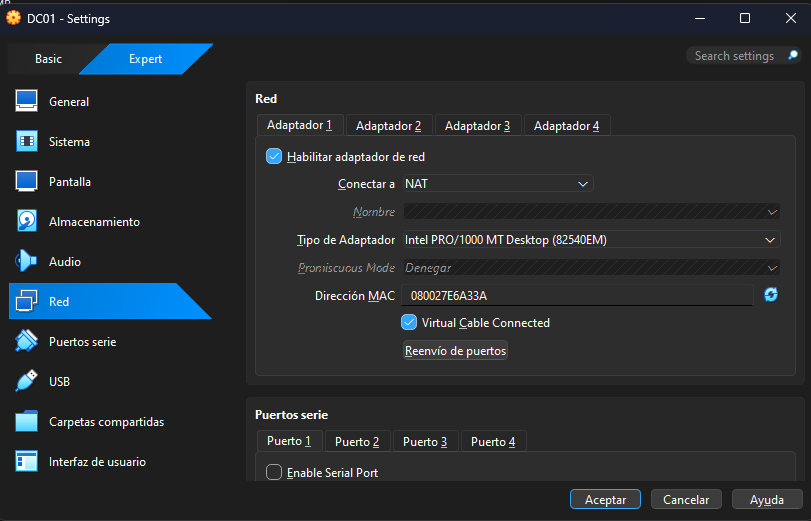
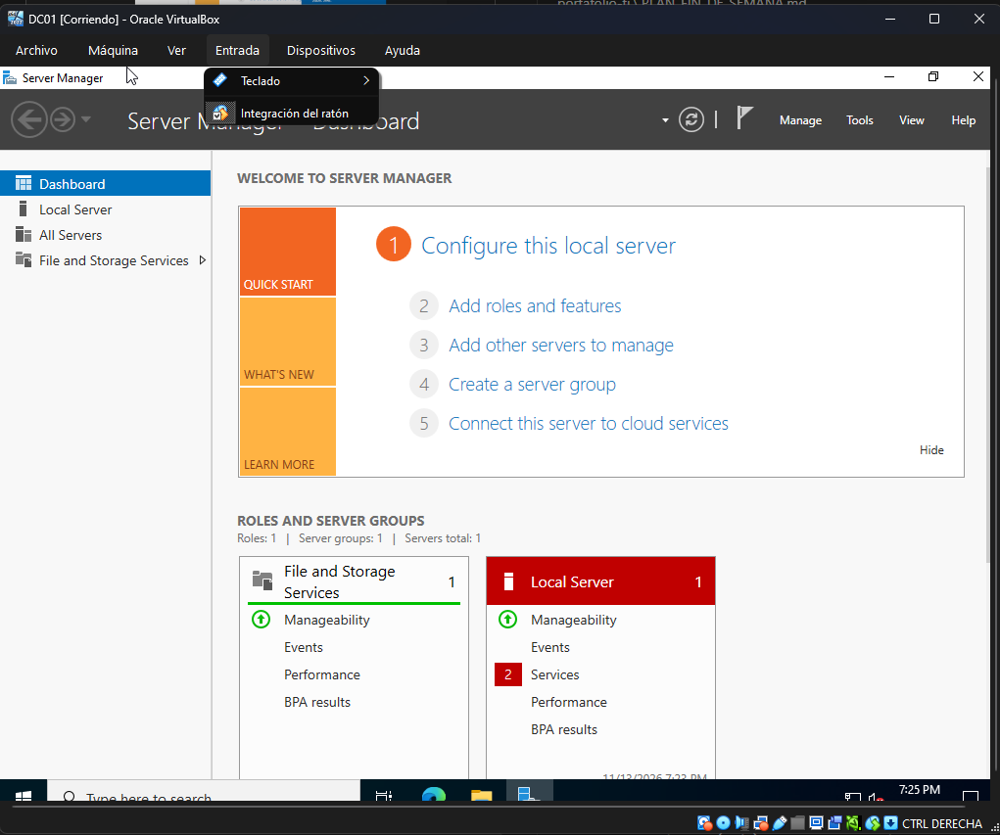
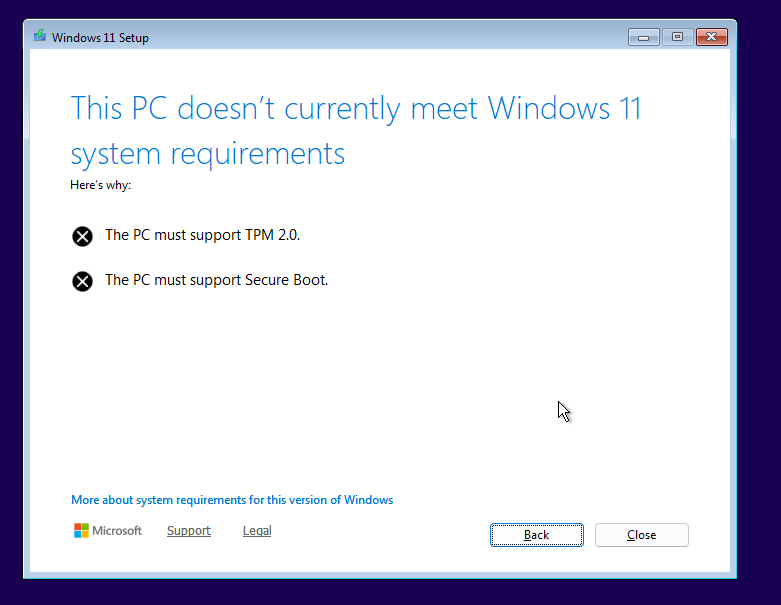
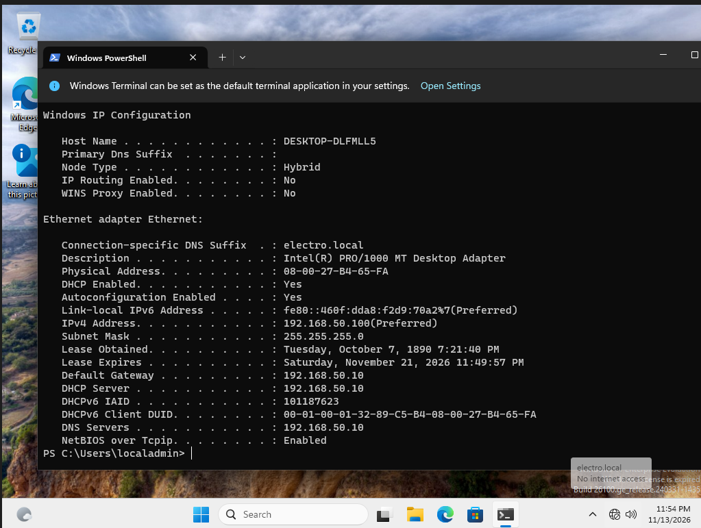
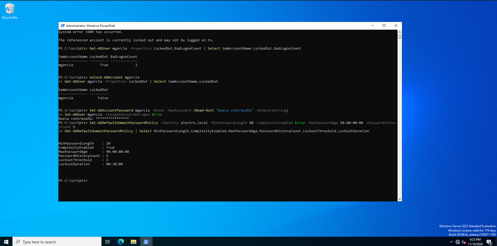
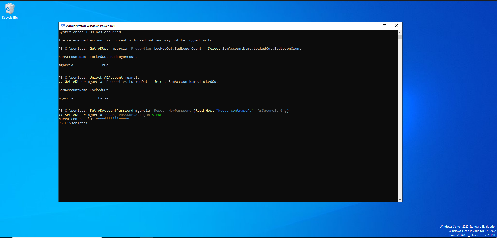

# How I built the Active Directory lab

🇪🇸 [Versión en español](GUIDE.es.md)

Domain: `electro.local` · Server: `DC01` (192.168.50.10) · Client: `PC01`

These are my notes from building the lab, in the order I did things, with the commands I ran. The problems I hit along the way are in the [README](README.md).

## Before I started: network and virtual machines

I made two VMs in VirtualBox:

| VM | Adapter 1 | Adapter 2 | Resources |
|---|---|---|---|
| DC01 (Windows Server 2022) | NAT (internet) | Internal network `labnet` | 4 GB RAM, 2 CPU, 50 GB |
| PC01 (Windows 11 Enterprise) | Internal network `labnet` | none | 4 GB RAM, 2 CPU, 60 GB |

The internal network is where the domain lives. DC01 also has a NAT adapter so the server can reach the internet. PC01 only sees `labnet`.

For PC01 I used BIOS firmware and TPM set to "none", because with EFI the VM stayed on a black screen. With 16 GB of RAM on my PC both VMs run at the same time without trouble.


*DC01, adapter 1: NAT (internet)*

*DC01, adapter 2: internal network `labnet`*

### How I moved scripts into the VMs
I turned on the shared clipboard (Devices → Shared Clipboard → Bidirectional), copied the file on my PC and pasted it inside the VM with:

```powershell
Get-Clipboard | Set-Content C:\scripts\name.ps1 -Encoding UTF8
```

When I saved files with Notepad I had to pick "All files" as the type, or they ended up as `.txt`. I also had to open PowerShell with "Run as administrator" from the Start menu, because the Windows Terminal one gave me an error.

## 1. Install Windows Server 2022
1. New VM, type Windows 2022, evaluation ISO.
2. I chose **Standard Evaluation (Desktop Experience)**. Without Desktop Experience there is no graphical interface.
3. I set an Administrator password just for the lab (it isn't in the repo).
4. Installed Guest Additions from the Devices menu and rebooted.


*Server Manager on the fresh Windows Server 2022*

## 2. Promote it to domain controller
In PowerShell as administrator on DC01 I first checked the adapter names:

```powershell
Get-NetAdapter
```

Then I ran [scripts/01-Setup-DC.ps1](scripts/01-Setup-DC.ps1), after setting `$LabAdapter` to the internal network adapter (`Ethernet 2` in my case). The script works in phases and reboots the server twice. My first attempt failed because the DSRM password didn't meet the complexity rules, so I ran `Install-ADDSForest` again with a stronger one.

To check the result:
```powershell
Get-ADDomain
Get-Service NTDS, DNS, Netlogon
dcdiag /q
```


*`Get-ADDomain` after the promotion*

### Cleaning up DNS (server with two network cards)
Since DC01 has the NAT card, it registered those IPs (`10.0.2.15` and an IPv6 one) in DNS too, and clients got addresses that didn't work. I stopped the NAT adapter from registering and deleted the record that was already created:

```powershell
Set-DnsClient -InterfaceAlias "Ethernet" -RegisterThisConnectionsAddress $false
Remove-DnsServerResourceRecord -ZoneName electro.local -Name "dc01" -RRType A -RecordData 10.0.2.15 -Force
```
From a client, `nslookup electro.local` should only return `192.168.50.10`.

## 3. DHCP
I ran [scripts/02-Setup-DHCP.ps1](scripts/02-Setup-DHCP.ps1) on DC01. It creates the `LAN-Lab` scope (192.168.50.100 to 200) with DNS, domain and gateway pointing to DC01.


*DHCP scope `LAN-Lab` active on DC01*

## 4. Windows 11 client and domain join
1. I created the PC01 VM with a single adapter on `labnet`.
2. The Windows 11 installer said "This PC doesn't meet the system requirements" because the VM has no TPM or Secure Boot. I pressed Shift+F10 and in the console ran:
   ```cmd
   reg add HKLM\SYSTEM\Setup\LabConfig /v BypassTPMCheck /t REG_DWORD /d 1 /f
   reg add HKLM\SYSTEM\Setup\LabConfig /v BypassSecureBootCheck /t REG_DWORD /d 1 /f
   exit
   ```
   Then I went back one step in the installer and continued.
3. I created a local account (`localadmin`). Once Windows was installed I checked that PC01 got its IP from DHCP:
   ```powershell
   ipconfig /all        # IP 192.168.50.1xx, DNS 192.168.50.10
   nslookup electro.local
   ```
4. I joined the domain from PowerShell **as administrator** (the first time I forgot and got "Access is denied"):
   ```powershell
   Add-Computer -DomainName electro.local -Credential electro\administrator -Restart
   ```
5. After the reboot I signed in as `administrator@electro.local`.

To type domain accounts I use `user@electro.local`, so I don't depend on the `\` key, which is in a different place depending on the keyboard layout. If a join fails, I check DNS first: the client has to use `192.168.50.10`.


*The Windows 11 installer blocking on TPM and Secure Boot*

*PC01 with an IP from the DHCP scope and DC01 as DNS*

*PC01 joined to `electro.local`*

## 5. OUs, groups and users in bulk
I copied `03-New-BulkUsers.ps1` and `users.csv` to `C:\scripts` on DC01 and ran:

```powershell
cd C:\scripts
Set-ExecutionPolicy -Scope Process Bypass -Force
.\03-New-BulkUsers.ps1 -WhatIf     # simulates, creates nothing
.\03-New-BulkUsers.ps1             # real run; asks for the initial password
```

The initial password has to meet the domain policy, and every user must change it at their first sign-in. To check:
```powershell
Get-ADOrganizationalUnit -Filter * -SearchBase "OU=Empresa,DC=electro,DC=local" | Select Name
Get-ADGroup -Filter "Name -like 'GG_*'" | Select Name
Get-ADUser -Filter * -SearchBase "OU=Empresa,DC=electro,DC=local" | Select Name, SamAccountName, Enabled
```
That gave me 7 OUs (Empresa, Grupos and the 5 departments), 5 `GG_*` groups and 10 users.


*OUs, `GG_*` groups and the 10 users created by the script*

## 6. Help Desk tasks

### 6.1 Password and lockout policy (domain level)
```powershell
Set-ADDefaultDomainPasswordPolicy -Identity electro.local `
  -MinPasswordLength 10 -ComplexityEnabled $true `
  -MaxPasswordAge 90.00:00:00 -PasswordHistoryCount 5 `
  -LockoutThreshold 3 -LockoutDuration 00:30:00 -LockoutObservationWindow 00:30:00
Get-ADDefaultDomainPasswordPolicy
```
This kind of policy only applies at domain level. A regular GPO linked to an OU can't set it.


*Domain password and lockout policy*

### 6.2 Locking, unlocking and resetting an account
To lock `mgarcia` on purpose I used a wrong password three times from DC01:
```powershell
net use \\DC01\IPC$ /user:mgarcia@electro.local WrongPass1!
Get-ADUser mgarcia -Properties LockedOut, BadLogonCount | Select SamAccountName, LockedOut, BadLogonCount
```
Then I unlocked it and reset the password:
```powershell
Search-ADAccount -LockedOut | Select Name, SamAccountName
Unlock-ADAccount -Identity mgarcia
Set-ADAccountPassword -Identity mgarcia -Reset -NewPassword (Read-Host "New password" -AsSecureString)
Set-ADUser mgarcia -ChangePasswordAtLogon $true
```
The same can be done with the GUI, in "Active Directory Users and Computers" (`dsa.msc`), right-clicking the user.


*`mgarcia` locked out after 3 failed attempts*

*Account unlocked and password reset*

### 6.3 GPO: restrict Control Panel
I did this one with the graphical console:
1. `gpmc.msc` → right-click the **Operaciones** OU → *Create a GPO in this domain, and Link it here* → `GPO-Restringir-PanelControl`.
2. Edit → User Configuration → Policies → Administrative Templates → Control Panel → **Prohibit access to Control Panel and PC settings** → Enabled.

I tested it on PC01 with `mgarcia`: `gpupdate /force`, sign out and back in. Opening Control Panel shows a restriction message. A user from another OU can open it normally.


*`GPO-Restringir-PanelControl` linked to the Operaciones OU*

*`mgarcia` on PC01: Control Panel blocked by the GPO*

### 6.4 Shared folder with group permissions
```powershell
New-Item -ItemType Directory -Force C:\Shares\Compras | Out-Null
New-SmbShare -Name Compras -Path C:\Shares\Compras `
  -FullAccess "ELECTRO\Domain Admins" -ChangeAccess "ELECTRO\GG_Compras"
icacls C:\Shares\Compras /inheritance:r
icacls C:\Shares\Compras /grant "ELECTRO\Domain Admins:(OI)(CI)F" "ELECTRO\GG_Compras:(OI)(CI)M" "SYSTEM:(OI)(CI)F"
```
From PC01, `cramirez` (Compras) opens `\\DC01\Compras` and can create files. `mgarcia` (Operaciones) gets "You do not have permission to access".


*Share and NTFS permissions on `Compras`*

*`cramirez` (Compras) can open and write in the share*

*`mgarcia` (Operaciones) is denied*

### 6.5 GPO: map the folder as a network drive
1. `gpmc.msc` → right-click the **Compras** OU → *Create a GPO in this domain, and Link it here* → `GPO-Mapear-Compras`.
2. Edit → User Configuration → Preferences → Windows Settings → **Drive Maps** → New → Mapped Drive.
3. Action: Create · Location: `\\DC01\Compras` · Reconnect checked · Drive Letter: `S:`.

I tested it on PC01 with `cramirez`: `gpupdate /force`, sign out and back in. The `S:` drive shows up under "This PC".


*`GPO-Mapear-Compras` linked to Compras, with the S: drive map*

*`cramirez` on PC01 with the S: drive mapped*

## Notes
- The screenshots are in [`evidence/`](evidence/), numbered in the order I took them.
- PC01's evaluation license shows "Notification" mode because of the VM clock during install. It doesn't stop the lab, but the VM shuts itself down every so often, and I just turn it back on.
