# How I built the help desk with osTicket

🇪🇸 [Versión en español](GUIDE.es.md)

These are my notes from setting up the help desk, in the order I did things. The problems I hit are in the [README](README.md). Everything I typed inside osTicket is in Spanish.

## 1. Docker and the containers

I installed Docker Desktop with `winget install -e --id Docker.DockerDesktop`. The first time it asked for the Windows "Virtual Machine Platform" feature, so I enabled it and rebooted:

```powershell
Enable-WindowsOptionalFeature -Online -FeatureName VirtualMachinePlatform
```

Then I copied `.env.example` to `.env` and put my own values (only letters and numbers, so keyboard layouts don't cause trouble), and started everything:

```powershell
cd 02-osticket-helpdesk
copy .env.example .env
docker compose up -d
docker compose ps
docker compose logs osticket
```

This image installs osTicket by itself the first time it starts, using the variables in [`docker-compose.yml`](docker-compose.yml). There is no web installer. The log ends with "Database installation successful". After that:

- Users: `http://localhost:8080`
- Agents: `http://localhost:8080/scp` (user `ostadmin`, password from my `.env`)

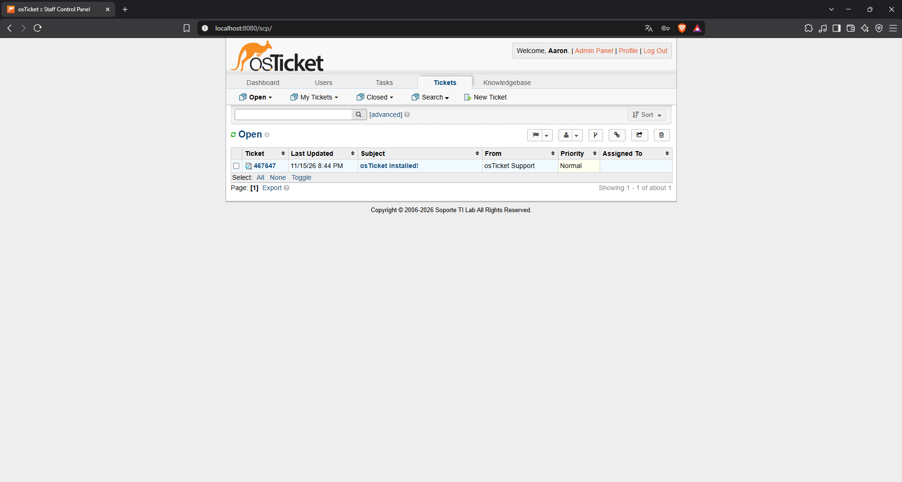
*The agent panel after the first login. The only ticket is the welcome ticket osTicket creates.*

## 2. Departments

In Admin Panel → Agents → Departments I renamed the two that osTicket creates and added a third:

| Department | What it is for |
|---|---|
| Soporte TI | Accounts, computers, software |
| Redes | Internet, Wi-Fi, VPN |
| Impresoras y periféricos | Printers, scanners, mouse and keyboard |

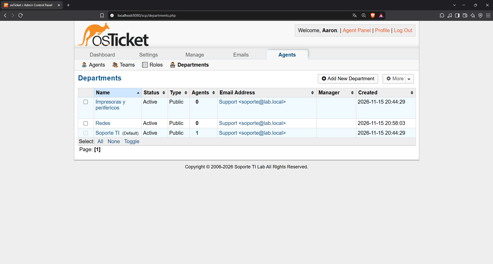

## 3. SLA plans

In Admin Panel → Manage → SLA I created four plans. The grace period is in hours. I also set Normal as the default plan in Settings → Tickets.

| Plan | Grace period | When it applies |
|---|---|---|
| Crítico | 1 h | Service down, the user can't work |
| Alto | 4 h | Affects one person, there is a workaround |
| Normal | 24 h | Standard request |
| Bajo | 72 h | Improvement or question, not urgent |

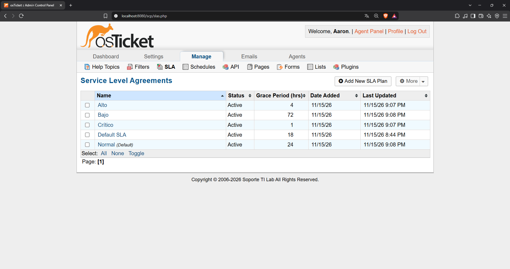

## 4. Help topics

In Admin Panel → Manage → Help Topics I created seven topics and, in the "New ticket options" tab, linked each one to a department, an SLA plan and a priority. I also removed the four English topics osTicket comes with.

| Topic | Department | SLA | Priority |
|---|---|---|---|
| Cuentas y contraseñas | Soporte TI | Alto | High |
| Red e Internet | Redes | Alto | High |
| Software | Soporte TI | Normal | Normal |
| Hardware | Soporte TI | Normal | Normal |
| Impresiones | Impresoras y periféricos | Normal | Normal |
| Solicitud de acceso | Soporte TI | Normal | Normal |
| Otros | Soporte TI | Bajo | Low |

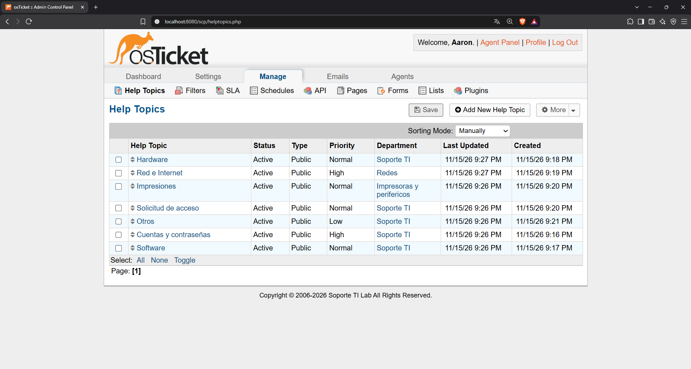

## 5. Canned responses

In the Agent Panel → Knowledgebase → Canned Responses I created four, with the variables `%{ticket.name.first}` and `%{ticket.number}` so they fill in the user's name and the ticket number. The full texts are in [`canned-responses.md`](canned-responses.md).

- Ticket recibido
- Solicitamos más información
- Resuelto: confirma por favor
- Cierre por falta de respuesta

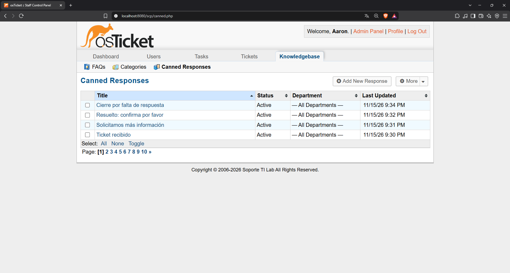

## 6. Agents

I created a second agent, Laura, with Redes as primary department and Soporte TI as extended access (Admin Panel → Agents → Agents). Later I also gave Aaron extended access to Redes, because an agent only sees tickets from the departments they have access to.

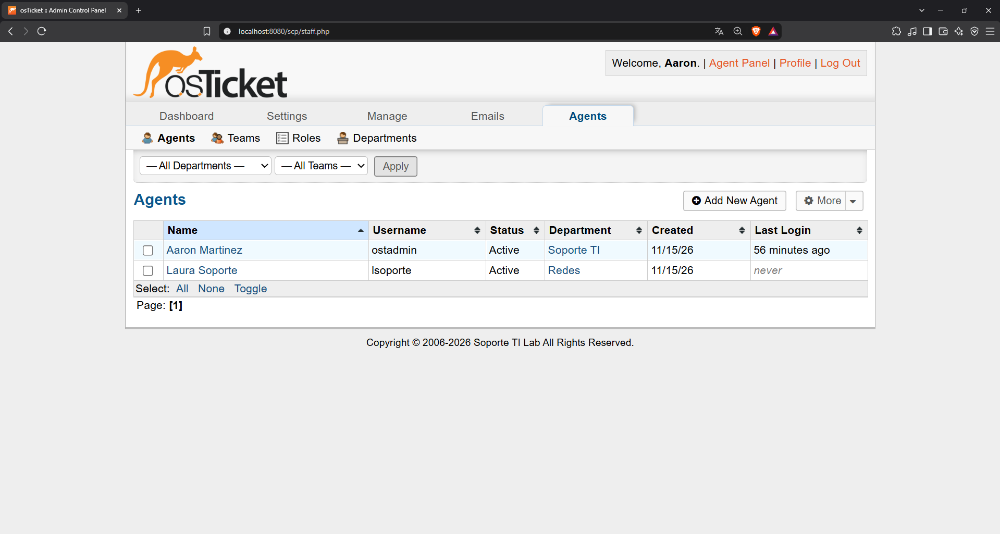

## 7. Tickets

I created ten tickets from New Ticket in the agent panel. Every one is written with the same structure:

```
Equipo: ...
Descripción: ...
Mensaje de error: ...
Desde cuándo: ...
Impacto: ...
```

For each ticket I did the same steps:
1. Open it with the user's email, choose the help topic, the department, the SLA, the priority and who it is assigned to. The initial response is the *Ticket recibido* template, and the triage goes in an internal note.
2. Write the cause and the solution in an internal note.
3. Reply with the *Resuelto: confirma por favor* template.
4. The user confirms from the portal (`http://localhost:8080/view.php`, with their email and the ticket number), pretending to be them.
5. Close the ticket with an internal note.

The users are the same ones from the Active Directory lab, with `@example.com` emails. The full list is in [`simulated-tickets.md`](simulated-tickets.md).

### One ticket per area

**Soporte TI, account locked (#199835).**

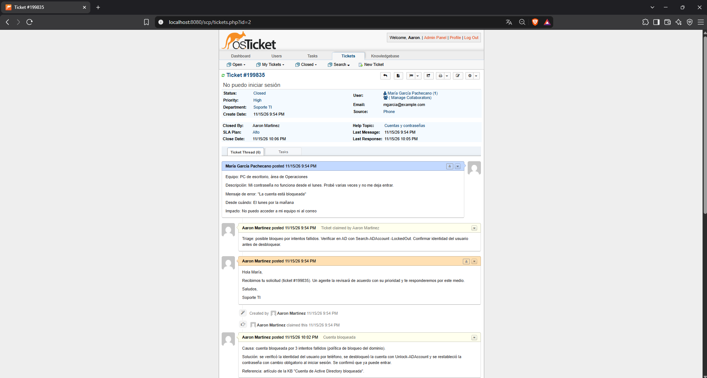
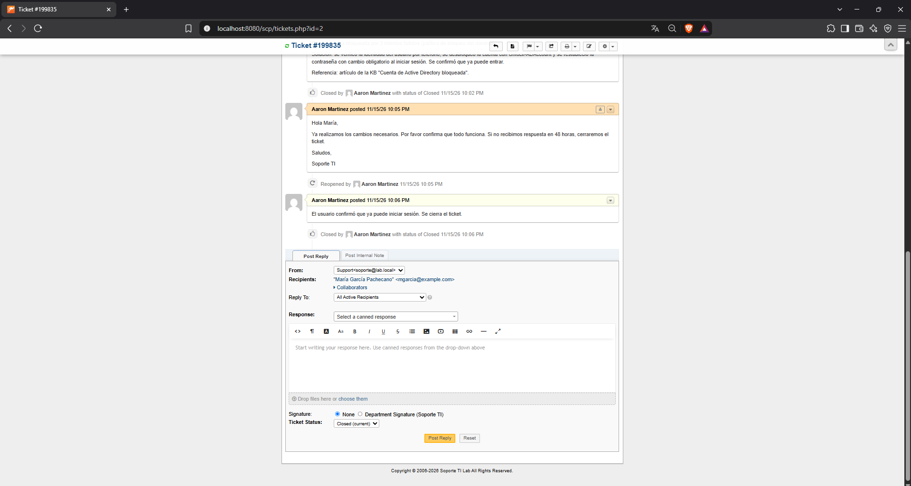

**Impresoras y periféricos, stuck print queue (#799525).**

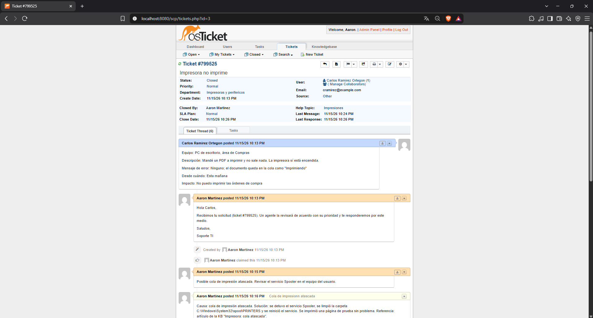
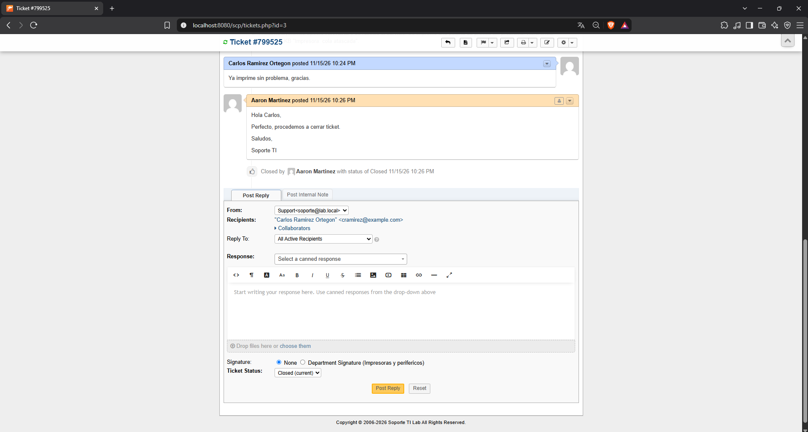

**Redes, no internet, solved by Laura (#764102).**

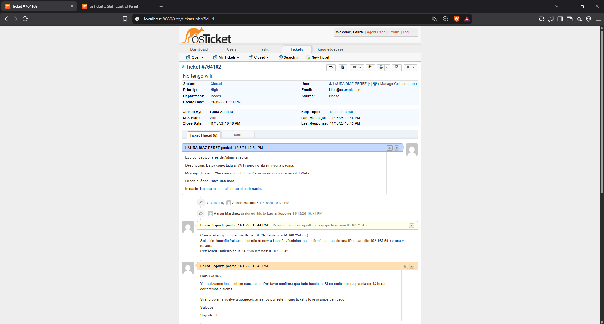
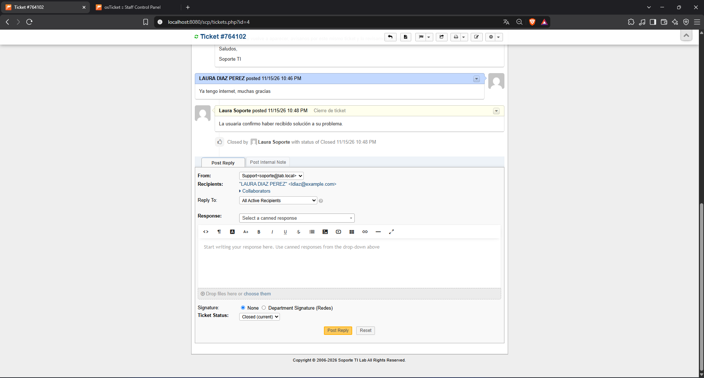

### Transfer between departments

Ticket #541839 ("No abre carpeta compartida") came in under Redes, but the error was a permission problem, not a network one. Laura transferred it to Soporte TI with a note and it was solved there (the user wasn't in the `GG_Compras` group).

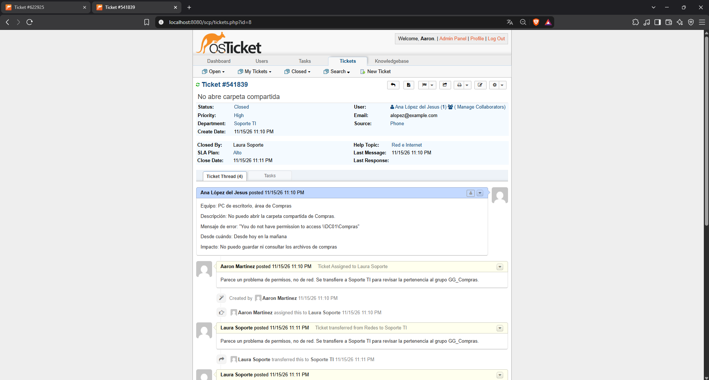
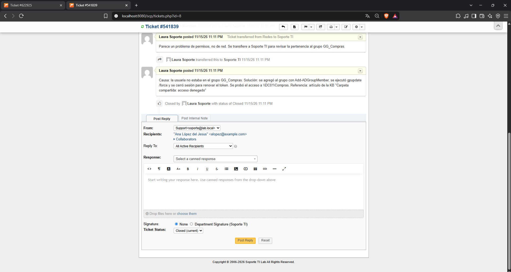

### SLA overdue

Ticket #622925 ("VPN no conecta") uses the Crítico plan and the Emergency priority. osTicket doesn't let me set a due date in the past, so I set it a few minutes ahead, and osTicket's scheduled task (it runs every 5 minutes) flagged it as overdue.

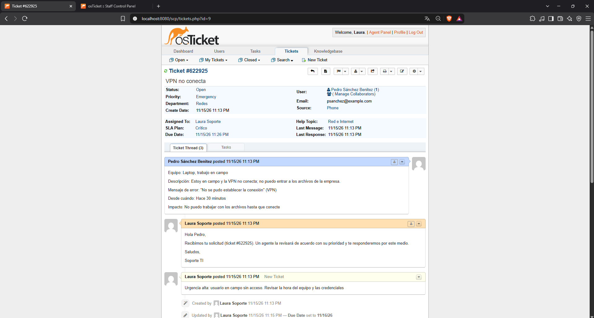
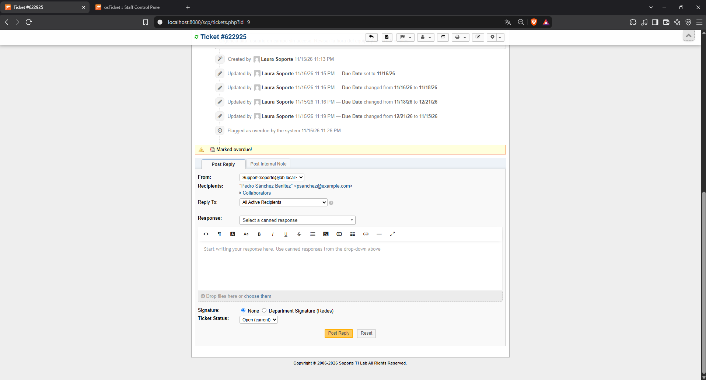

### Closed tickets

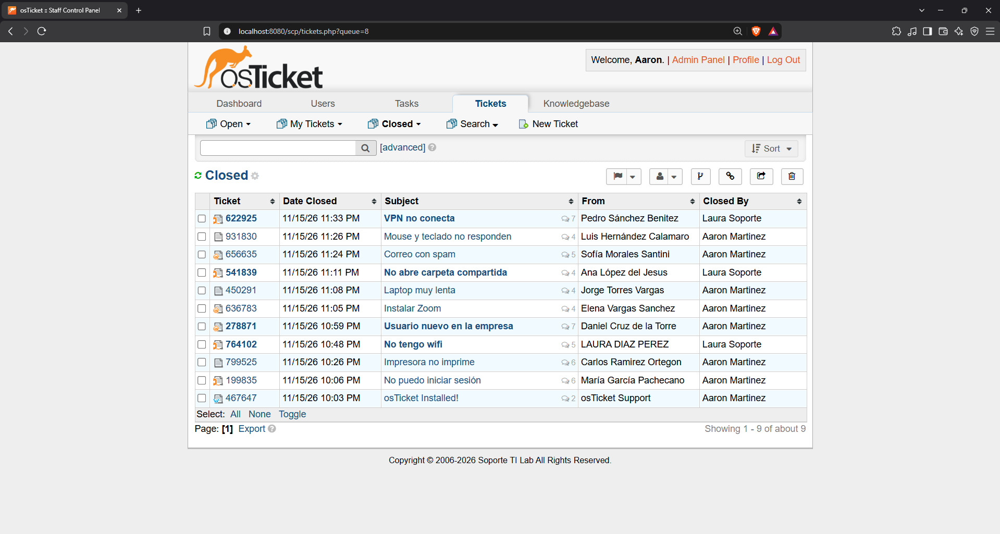

## 8. Knowledge base

In the Agent Panel → Knowledgebase I created a public category, "Soporte TI", and four articles. The ticket solutions point to them. The texts are in [`kb/`](kb/).

- Cuenta de Active Directory bloqueada
- Impresora: cola atascada
- Sin internet: IP 169.254
- Carpeta compartida: acceso denegado

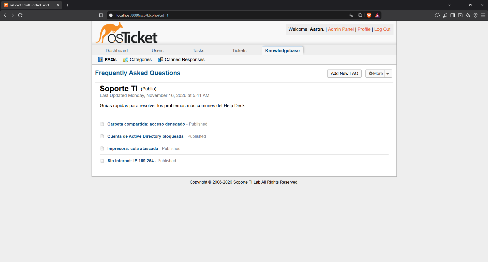
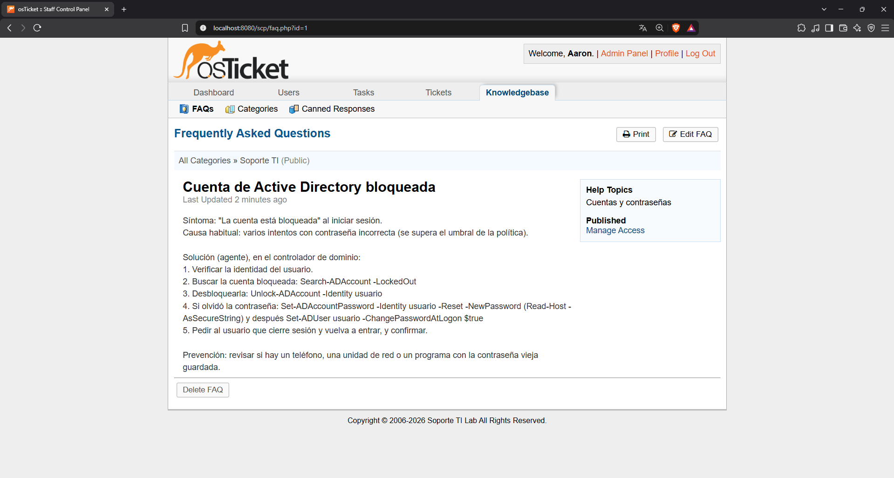

## Notes

- The lab has no mail server, so osTicket can't send emails. It shows errors when it tries, but the tickets are created anyway.
- To let users check a ticket without an emailed link, I turned off "Require email verification on Check Ticket Status" in Settings → Users.
- osTicket doesn't accept `.local` email addresses. I used `example.com`.
- osTicket shows times in UTC, six hours ahead of my PC.
- The `.env` file is not in the repository.
