# Laboratorio de automatización de operaciones: una empresa de reciclaje

🇺🇸 [Read in English](README.md)

Un laboratorio donde convertí operaciones de papel y hojas de cálculo en flujos automáticos, una base de datos y un dashboard, con n8n, PostgreSQL y Metabase en Docker. La empresa es **ficticia**: un negocio de reciclaje con camiones en el Noroeste del Pacífico y Florida, a punto de expandirse al Caribe. Lo armé después de leer lo que pide este tipo de puesto: tickets de carga, un corte diario de facturas, facturación contra órdenes de compra, un embudo de prospectos, dashboards y procedimientos escritos.

**Estado:** 🟡 casi listo (falta el video) · **Tiempo invertido:** unas 5 h · **Fecha:** noviembre 2026

## Qué automatiza

| # | Flujo | Qué hace |
|---|---|---|
| 01 | Load ticket intake | Un formulario captura cada entrega (pesos, horas, millas, combustible), revisa los datos y los guarda. Devuelve las toneladas, las horas en carretera, el rendimiento (mpg) y el pago del chofer |
| 02 | Daily invoice reminder | Cada día hábil a las 9:30 AM ET manda por correo las facturas que faltan por capturar, antes del corte de las 10:00 AM ET |
| 03 | Invoice from a purchase order | Junta todas las cargas sin facturar de una orden de compra en una factura, la manda por correo y la deja en la cola del portal de factoraje |
| 04 | New lead | Un formulario agrega un prospecto al embudo, con una primera llamada para el día siguiente |
| 05 | Daily lead follow-ups | Cada día hábil a las 8:00 AM ET manda por correo los seguimientos que vencen, con un mensaje sugerido en inglés o en español |
| 06 | Mark invoice as entered | Cierra el ciclo: cuando una factura ya está en el portal, sale de la lista de pendientes |

Los archivos de los flujos están en [`workflows/`](workflows/). Los procedimientos están en [`sops/`](sops/):
[captura diaria de facturas](sops/01-daily-invoice-entry.es.md) · [tickets de carga](sops/02-load-ticket-capture.es.md) · [facturación contra una orden de compra](sops/03-invoicing-against-a-purchase-order.es.md) · [alta y seguimiento de prospectos](sops/04-lead-intake-and-follow-up.es.md)

## Entorno

| Parte | Detalle |
|---|---|
| n8n | 2.47, flujos y formularios (`http://localhost:5678`) |
| PostgreSQL | 16, datos del negocio en la base `ops` |
| Metabase | dashboards (`http://localhost:3000`) |
| Mailpit | una bandeja de prueba que recibe todos los correos de los flujos (`http://localhost:8025`) |
| Despliegue | Docker Compose en Windows 11, [`docker-compose.yml`](docker-compose.yml) + [`.env.example`](.env.example) |

La base de datos y los 75 días de historial ficticio de cargas salen de [`db/init/`](db/init/). Hay algo plantado a propósito: en las últimas dos semanas el consumo de combustible de un chofer empeora cerca de 25 %, para que el dashboard tenga un problema que encontrar.

### Cómo ejecutarlo
```bash
copy .env.example .env          # pon tus propios valores
docker compose up -d
docker compose exec n8n n8n import:workflow --input=/workflows/01-load-ticket-intake.json
# repite con los otros cinco archivos de workflows/
```
Después, en n8n, crea dos credenciales con los nombres que usan los flujos: **Ops database** (PostgreSQL: host `db`, base `ops`, usuario y contraseña de tu `.env`) y **Mailpit** (SMTP: host `mailpit`, puerto `1025`, sin SSL, cualquier usuario y contraseña). Abre cada flujo, elige esas credenciales en los nodos de base de datos y de correo, y publícalo.

## Dashboard

Nueve gráficas en Metabase, todas a partir de vistas SQL: cargas por día, toneladas por hora por chofer, consumo de combustible por chofer por semana, rendimiento de combustible, ingresos (últimos 7 días y por cliente), pago a choferes por mes, facturas pendientes y prospectos por etapa.

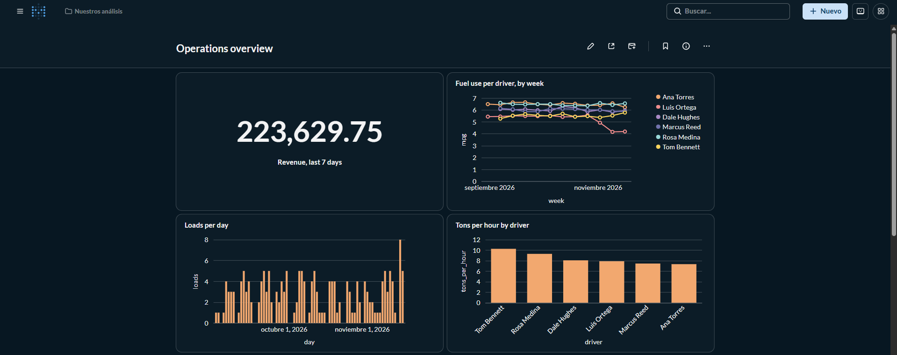
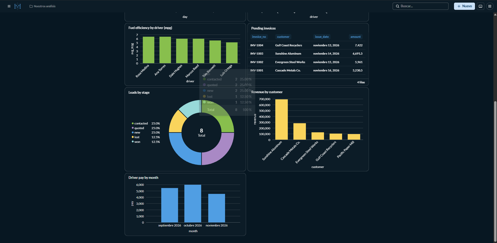
*La línea rosa de "Fuel use per driver, by week" es el chofer cuyo consumo de combustible empeoró.*

## Evidencia

Todas las capturas salen del sistema funcionando, en el orden en que una entrega pasa por él: del formulario al dashboard. Los archivos están en [`evidence/`](evidence/).

### 1. Captura de un ticket de carga
El formulario revisa los datos y responde con lo que calculó.

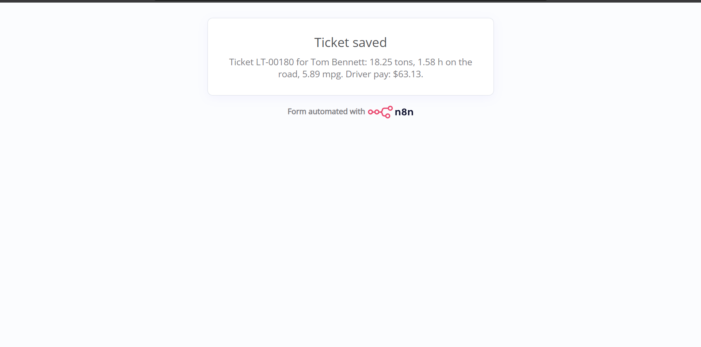
*Un ticket guardado. El sistema devuelve las toneladas, las horas en carretera, las millas por galón y el pago del chofer.*

Si algo está mal, lo dice y no guarda nada.

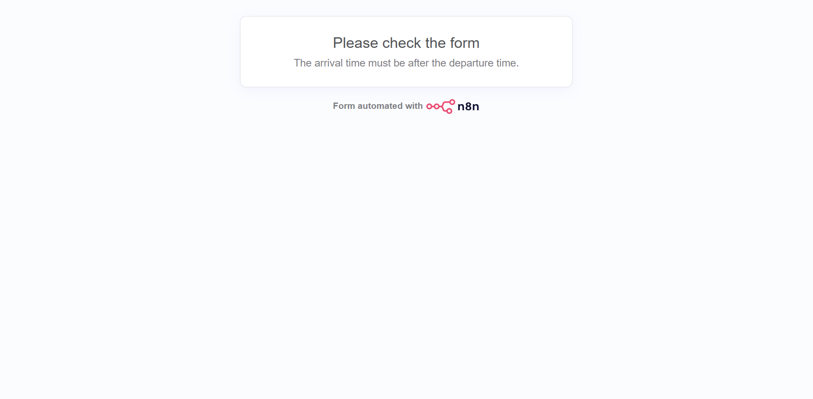
*Aquí la hora de llegada era anterior a la de salida, así que se rechazó el ticket. También revisa los pesos, las millas, el combustible y el formato de las horas.*

### 2. El flujo detrás del formulario
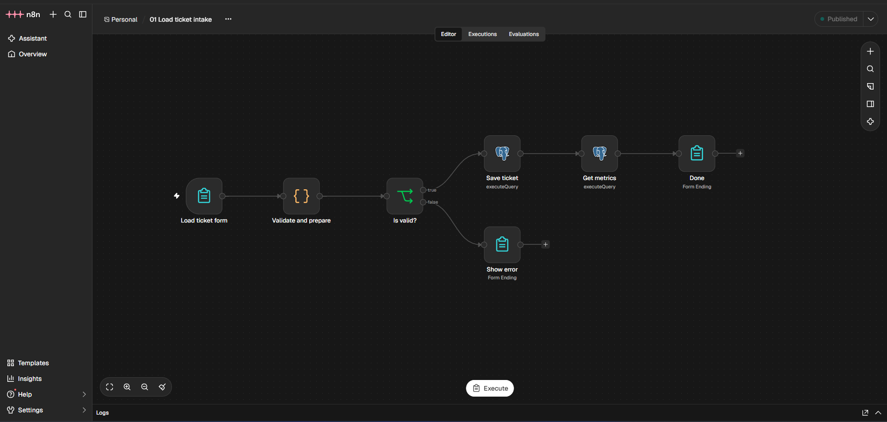
*El flujo 01 en n8n. El formulario pasa por un paso de validación. Si los datos son válidos, se guardan en PostgreSQL y se leen los números calculados para responder al usuario. Si no, se muestra una pantalla de error.*

### 3. El recordatorio diario de facturas
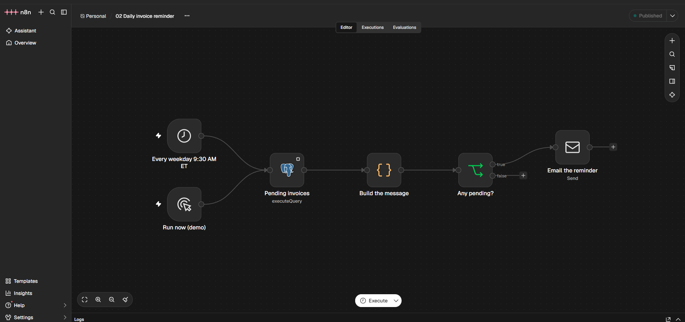
*El flujo 02. Arranca cada día hábil a las 9:30 AM hora del Este (o a mano, para una demostración), lee las facturas pendientes y manda un correo solo si hay alguna.*

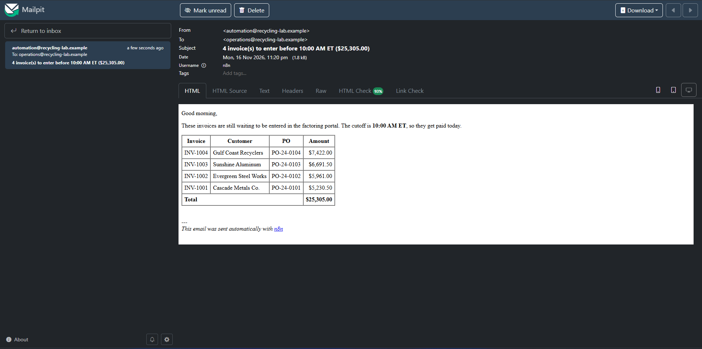
*El correo que manda: las facturas que faltan por capturar antes del corte de las 10:00 AM, con el total.*

### 4. Facturación contra una orden de compra
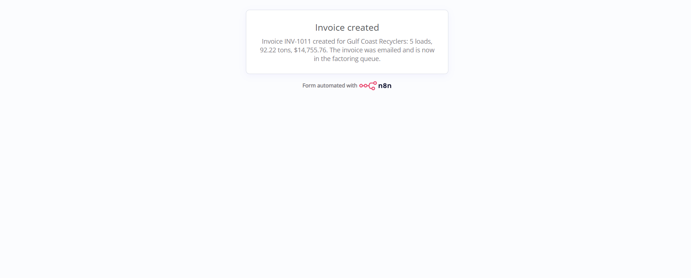
*El formulario de facturas junta todas las cargas sin facturar de una orden de compra en una sola factura y marca esas cargas como facturadas.*

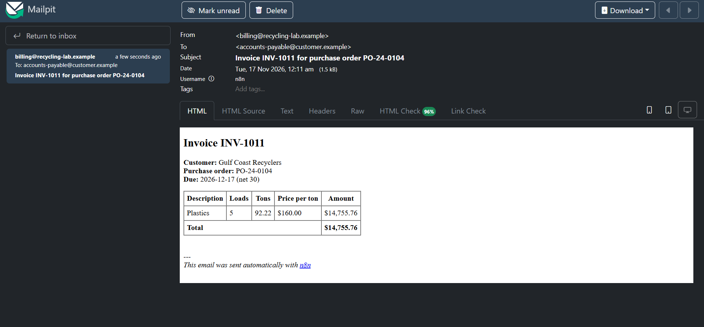
*La factura que salió por correo: cliente, orden de compra, toneladas, precio por tonelada, total y fecha de vencimiento (a 30 días).*

### 5. Prospectos y seguimientos
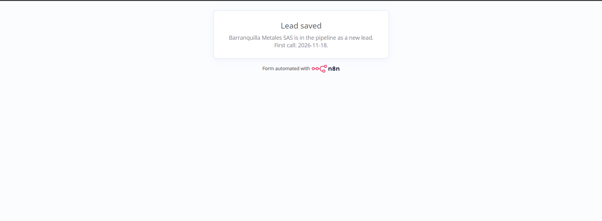
*Un prospecto nuevo se guarda en el embudo con una primera llamada para el día siguiente.*

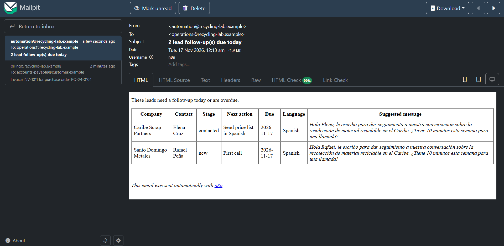
*El correo de la mañana con los seguimientos que vencen. Cada prospecto trae un mensaje sugerido en su propio idioma, aquí en español para el Caribe.*

### 6. El resultado en el dashboard
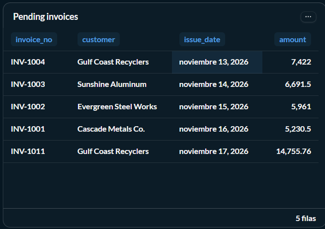
*Después de la factura del paso 4, la tabla "Pending invoices" del dashboard muestra la factura nueva (INV-1011). El formulario, la base de datos y el dashboard están conectados de punta a punta.*
## Problemas que tuve y cómo los resolví

1. **La base de datos no arrancó la primera vez.** Mi script de datos de ejemplo usaba `ROUND()` con un tipo decimal que PostgreSQL no acepta, la inicialización se detuvo a la mitad y el contenedor nunca quedó sano. Convertí el valor a `numeric` y recreé el volumen.
2. **El formulario daba 404.** n8n sirve el formulario en el ID del webhook, no en la ruta que yo escribí. Encontré la dirección real en la tabla `webhook_entity` de n8n.
3. **Probar desde la línea de comandos chocaba con el n8n que ya estaba corriendo.** Los dos intentaban usar el mismo puerto interno. Ejecutar la prueba con otro puerto lo arregló.
4. **Los datos de ejemplo eran demasiado planos.** Tres cargas cada día volvían aburrido el dashboard. Generé 75 días con semanas ocupadas, fines de semana tranquilos y un problema de combustible plantado.
5. **Mailpit rechazaba el inicio de sesión de n8n.** Mailpit no tiene cuentas por defecto, así que activé "aceptar cualquiera" para la bandeja de prueba.
6. **n8n avisa que PostgreSQL 16 solo tiene soporte parcial.** Todo funciona, pero n8n recomienda la 17 o más nueva. En una instalación real usaría la 17.

## Qué aprendí

- Un proceso es mucho más fácil de automatizar cuando los datos están limpios: listas desplegables, campos obligatorios y validación antes de guardar.
- Hacer el cálculo en la base de datos (vistas) mantiene los flujos simples y el dashboard consistente.
- Escribir el procedimiento (SOP) mientras armo el flujo deja ver qué pasos de verdad hacen falta.
- Las zonas horarias importan: el corte es en hora del Este, y en invierno estoy a seis horas de ella.

## Límites (lo que esto no es)

- Es una simulación. **No** se conecta a QuickBooks ni a ningún portal de factoraje o del banco; prepara las facturas y te dice qué capturar.
- Todos los datos son inventados, y no he trabajado en transporte ni en reciclaje. Lo que muestra el proyecto es cómo modelo y automatizo el proceso.
- Las etapas de los prospectos se actualizan directo en la base de datos. Un equipo real usaría una pantalla de CRM para eso.

## Cómo usé la IA

Usé Claude para ayudar a escribir la primera versión de los flujos, el SQL y la documentación, y para depurar errores. Yo armé y corrí el sistema, creé las cuentas, construí el dashboard en Metabase, probé cada formulario, arreglé lo que falló y tomé las capturas.
