# Operations Automation Lab: a recycling company

🇪🇸 [Leer en español](README.es.md)

A lab where I turned paper-and-spreadsheet operations into automated workflows, a database and a dashboard, using n8n, PostgreSQL and Metabase in Docker. The company is **fictional**: a recycling business with trucks in the Pacific Northwest and Florida that is about to expand into the Caribbean. I built it after reading what this kind of role asks for: load tickets, a daily invoice cutoff, billing against purchase orders, a lead pipeline, dashboards and written procedures.

**Status:** 🟡 almost done (video pending) · **Time spent:** about 5 h · **Date:** November 2026

## What it automates

| # | Workflow | What it does |
|---|---|---|
| 01 | Load ticket intake | A form captures each delivery (weights, times, miles, fuel), checks the data and saves it. It returns the tons, the hours on the road, the mpg and the driver pay |
| 02 | Daily invoice reminder | Every weekday at 9:30 AM ET it emails the invoices still waiting to be entered, before the 10:00 AM ET cutoff |
| 03 | Invoice from a purchase order | Groups all unbilled loads of a purchase order into one invoice, emails it and queues it for the factoring portal |
| 04 | New lead | A form adds a prospect to the pipeline, with a first call set for the next day |
| 05 | Daily lead follow-ups | Every weekday at 8:00 AM ET it emails the follow-ups that are due, with a suggested message in English or Spanish |
| 06 | Mark invoice as entered | Closes the loop: once an invoice is in the portal, it leaves the pending list |

The workflow files are in [`workflows/`](workflows/). The procedures are in [`sops/`](sops/):
[daily invoice entry](sops/01-daily-invoice-entry.md) · [load ticket capture](sops/02-load-ticket-capture.md) · [invoicing against a purchase order](sops/03-invoicing-against-a-purchase-order.md) · [lead intake and follow-up](sops/04-lead-intake-and-follow-up.md)

## Setup

| Part | Detail |
|---|---|
| n8n | 2.47, workflows and forms (`http://localhost:5678`) |
| PostgreSQL | 16, business data in the `ops` database |
| Metabase | dashboards (`http://localhost:3000`) |
| Mailpit | a test inbox that catches every email the workflows send (`http://localhost:8025`) |
| Deployment | Docker Compose on Windows 11, [`docker-compose.yml`](docker-compose.yml) + [`.env.example`](.env.example) |

The database and the 75 days of fictional load history come from [`db/init/`](db/init/). One thing is planted on purpose: in the last two weeks one driver's fuel use gets about 25 % worse, so the dashboard has a problem to find.

### How to run it
```bash
copy .env.example .env          # set your own values
docker compose up -d
docker compose exec n8n n8n import:workflow --input=/workflows/01-load-ticket-intake.json
# repeat for the other five files in workflows/
```
Then, in n8n, create two credentials with the names the workflows use: **Ops database** (PostgreSQL: host `db`, database `ops`, user and password from your `.env`) and **Mailpit** (SMTP: host `mailpit`, port `1025`, SSL off, any user and password). Open each workflow, pick those credentials in the database and email nodes, and publish it.

## Dashboard

Nine charts in Metabase, all from SQL views: loads per day, tons per hour by driver, fuel use per driver by week, fuel efficiency, revenue (last 7 days and by customer), driver pay by month, pending invoices and leads by stage.

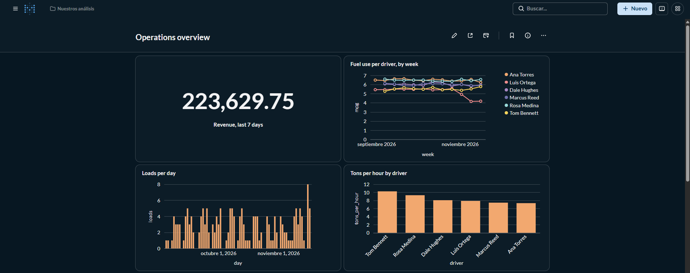
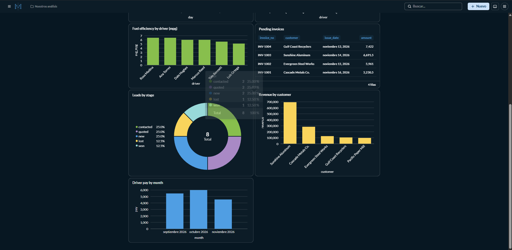
*The pink line in "Fuel use per driver, by week" is the driver whose fuel use got worse.*

## Evidence

Every screenshot comes from the running system, in the order a delivery goes through it: from the form to the dashboard. All files are in [`evidence/`](evidence/).

### 1. Capturing a load ticket
The form checks the data and answers with what it calculated.

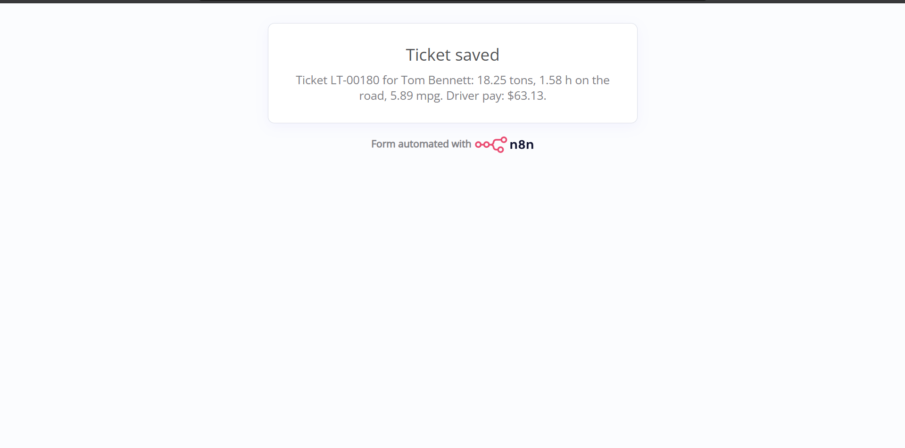
*A saved ticket. The system returns the tons, the hours on the road, the miles per gallon and the driver pay.*

If something is wrong, it says so and saves nothing.

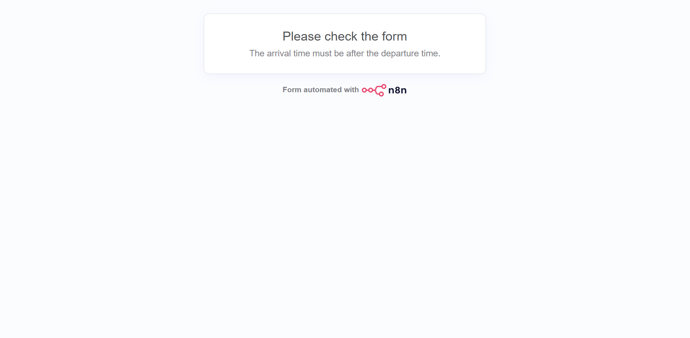
*Here the arrival time was before the departure time, so the ticket was rejected. It also checks the weights, the miles, the fuel and the time format.*

### 2. The workflow behind the form
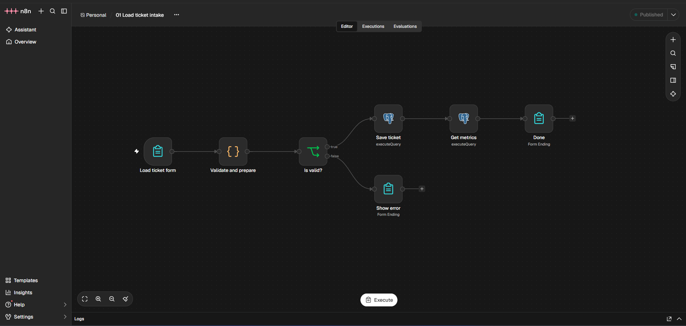
*Workflow 01 in n8n. The form feeds a validation step. If the data is valid, it is saved in PostgreSQL and the calculated numbers are read back to answer the user. If not, an error screen is shown.*

### 3. The daily invoice reminder
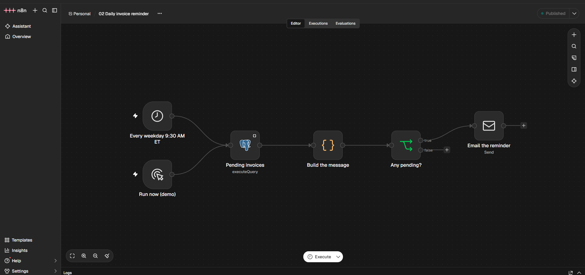
*Workflow 02. It starts every weekday at 9:30 AM Eastern Time (or by hand, for a demo), reads the pending invoices and sends an email only if there are any.*

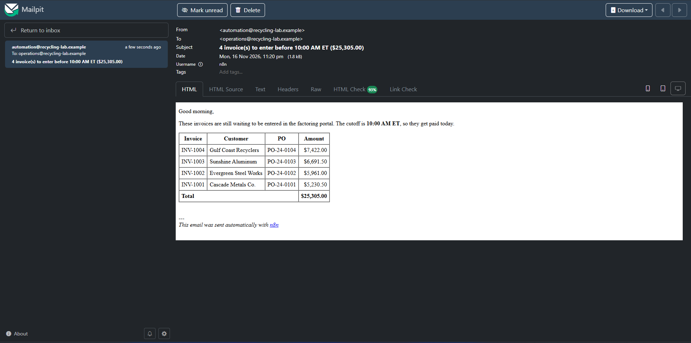
*The email it sends: the invoices still waiting to be entered before the 10:00 AM cutoff, with the total.*

### 4. Billing against a purchase order
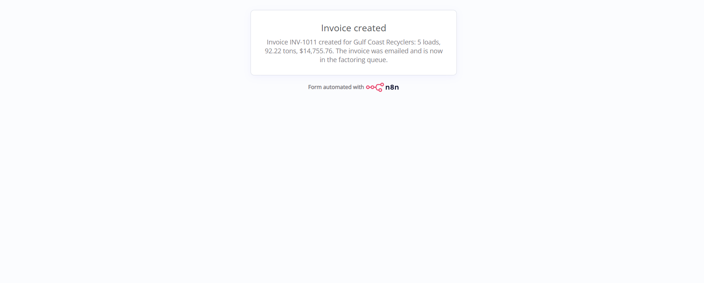
*The invoice form groups every unbilled load of a purchase order into one invoice and marks those loads as billed.*

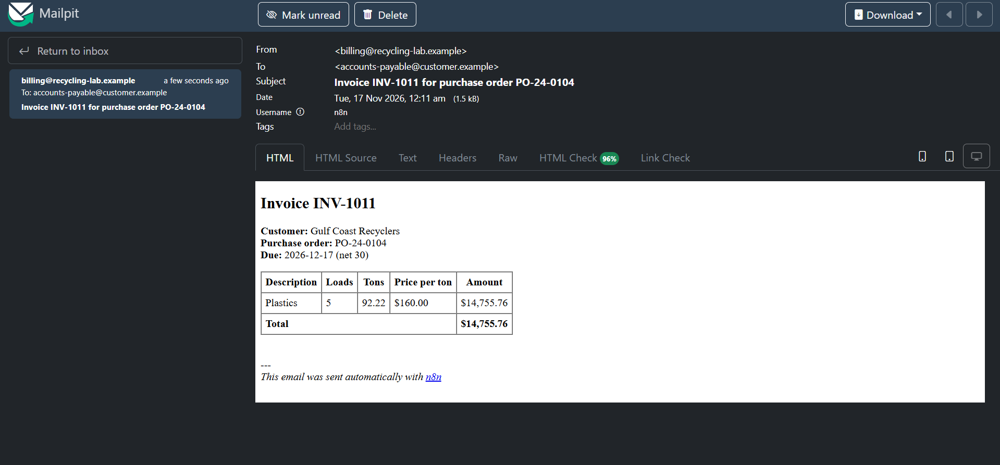
*The invoice that went out by email: customer, purchase order, tons, price per ton, total and due date (net 30).*

### 5. Leads and follow-ups

*A new lead is saved in the pipeline with a first call set for the next day.*

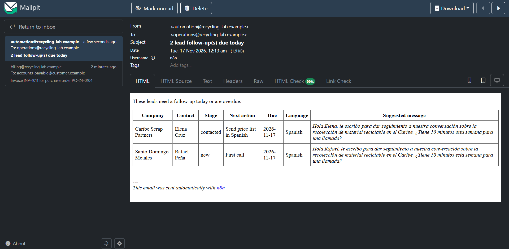
*The morning email with the follow-ups that are due. Each lead gets a suggested message in its own language, here in Spanish for the Caribbean.*

### 6. The result on the dashboard
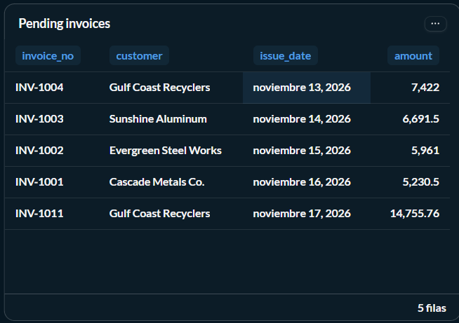
*After the invoice from step 4, the "Pending invoices" table on the dashboard shows the new invoice (INV-1011). The form, the database and the dashboard are connected from end to end.*
## Problems I ran into and how I fixed them

1. **The database didn't start the first time.** My sample-data script used `ROUND()` on a decimal type PostgreSQL doesn't accept, the init stopped halfway and the container never became healthy. I cast the value to `numeric` and recreated the volume.
2. **The form returned 404.** n8n serves a form at its webhook ID, not at the path I typed. I found the real address in n8n's `webhook_entity` table.
3. **Testing from the command line clashed with the running n8n.** Both tried to use the same internal port. Running the test with a different runner port fixed it.
4. **The sample data was too flat.** Three loads every day made the dashboard boring. I generated 75 days with busy weekdays, quiet weekends and one planted fuel problem.
5. **Mailpit rejected n8n's login.** Mailpit has no accounts by default, so I turned on "accept any" for the test inbox.
6. **n8n warns that PostgreSQL 16 is only partly supported.** Everything works, but n8n recommends 17 or newer. I would use 17 in a real setup.

## What I learned

- A process becomes much easier to automate once the data is clean: dropdowns, required fields and validation before saving.
- Doing the calculation in the database (views) keeps the workflows simple and the dashboard consistent.
- Writing the procedure (SOP) while building the workflow shows which steps are really needed.
- Time zones matter: the cutoff is Eastern Time, and I am six hours away from it in winter.

## Limits (what this is not)

- It is a simulation. It does **not** connect to QuickBooks or to any factoring or banking portal; it prepares the invoices and tells you what to enter.
- All data is made up, and I have not worked in trucking or recycling. What the project shows is how I model and automate the process.
- Lead stages are updated directly in the database. A real team would use a CRM screen for that.

## How I used AI

I used Claude to help write the first version of the workflows, the SQL and the documentation, and to debug errors. I set up and ran the stack, created the accounts, built the dashboard in Metabase, tested every form, fixed what failed and took the screenshots.
