# Cómo armé la mesa de ayuda con osTicket

🇺🇸 [English version](GUIDE.md)

Son mis notas de cómo armé la mesa de ayuda, en el orden en que fui haciendo las cosas. Los problemas que me salieron están en el [README](README.es.md). Todo lo que escribí dentro de osTicket está en español.

## 1. Docker y los contenedores

Instalé Docker Desktop con `winget install -e --id Docker.DockerDesktop`. La primera vez me pidió la característica de Windows "Virtual Machine Platform", así que la activé y reinicié:

```powershell
Enable-WindowsOptionalFeature -Online -FeatureName VirtualMachinePlatform
```

Luego copié `.env.example` a `.env` y puse mis propios valores (solo letras y números, para que el idioma del teclado no cause problemas), y levanté todo:

```powershell
cd it-support/osticket-helpdesk
copy .env.example .env
docker compose up -d
docker compose ps
docker compose logs osticket
```

Esta imagen instala osTicket sola la primera vez que arranca, con las variables de [`docker-compose.yml`](docker-compose.yml). No hay instalador web. El log termina con "Database installation successful". Después:

- Usuarios: `http://localhost:8080`
- Agentes: `http://localhost:8080/scp` (usuario `ostadmin`, contraseña de mi `.env`)

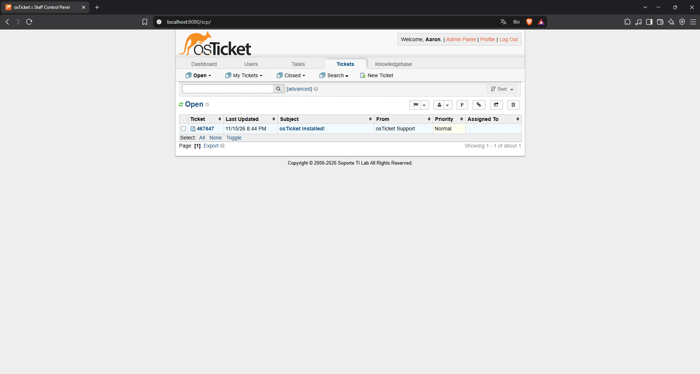
*El panel de agentes en el primer inicio de sesión. El único ticket es el de bienvenida que crea osTicket.*

## 2. Departamentos

En Admin Panel → Agents → Departments renombré los dos que crea osTicket y agregué un tercero:

| Departamento | Para qué |
|---|---|
| Soporte TI | Cuentas, equipos, software |
| Redes | Internet, Wi-Fi, VPN |
| Impresoras y periféricos | Impresoras, escáner, mouse y teclado |

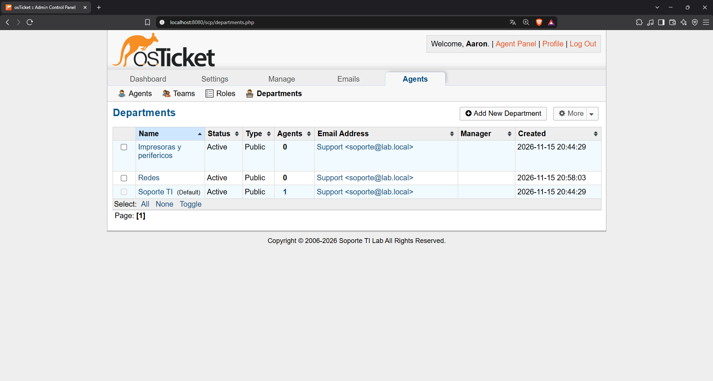

## 3. Planes de SLA

En Admin Panel → Manage → SLA creé cuatro planes. El tiempo de gracia está en horas. También dejé Normal como plan predeterminado en Settings → Tickets.

| Plan | Tiempo de gracia | Cuándo se usa |
|---|---|---|
| Crítico | 1 h | Servicio caído, el usuario no puede trabajar |
| Alto | 4 h | Afecta a una persona y tiene alternativa |
| Normal | 24 h | Solicitud estándar |
| Bajo | 72 h | Mejora o duda sin urgencia |

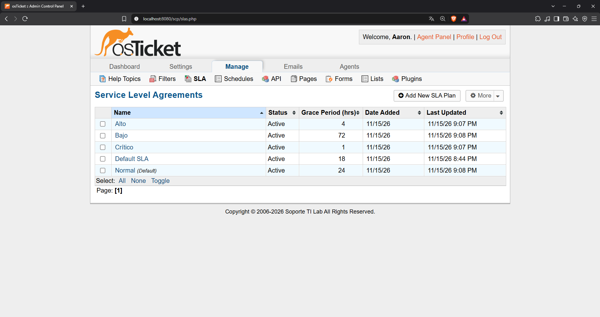

## 4. Temas de ayuda

En Admin Panel → Manage → Help Topics creé siete temas y, en la pestaña "New ticket options", ligué cada uno a un departamento, un plan de SLA y una prioridad. También quité los cuatro temas en inglés que trae osTicket.

| Tema | Departamento | SLA | Prioridad |
|---|---|---|---|
| Cuentas y contraseñas | Soporte TI | Alto | High |
| Red e Internet | Redes | Alto | High |
| Software | Soporte TI | Normal | Normal |
| Hardware | Soporte TI | Normal | Normal |
| Impresiones | Impresoras y periféricos | Normal | Normal |
| Solicitud de acceso | Soporte TI | Normal | Normal |
| Otros | Soporte TI | Bajo | Low |

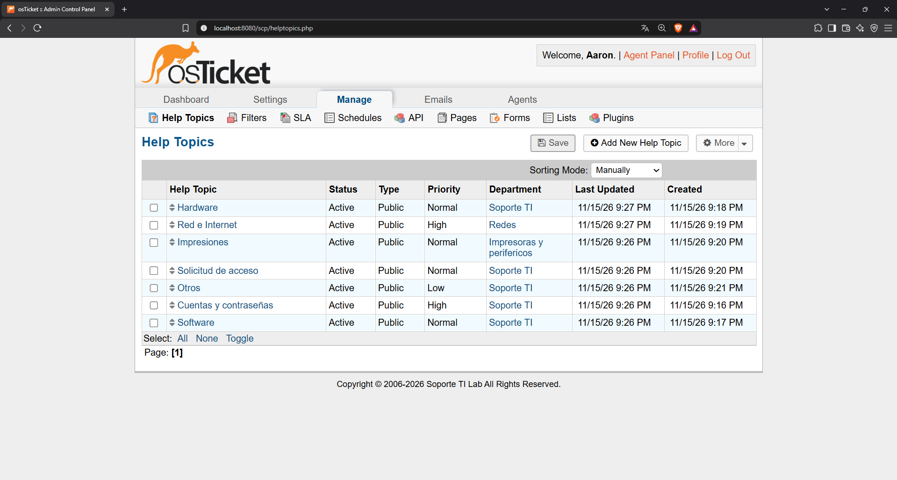

## 5. Plantillas de respuesta

En el Agent Panel → Knowledgebase → Canned Responses creé cuatro, con las variables `%{ticket.name.first}` y `%{ticket.number}` para que se llenen solas con el nombre del usuario y el número del ticket. Los textos completos están en [`canned-responses.es.md`](canned-responses.es.md).

- Ticket recibido
- Solicitamos más información
- Resuelto: confirma por favor
- Cierre por falta de respuesta

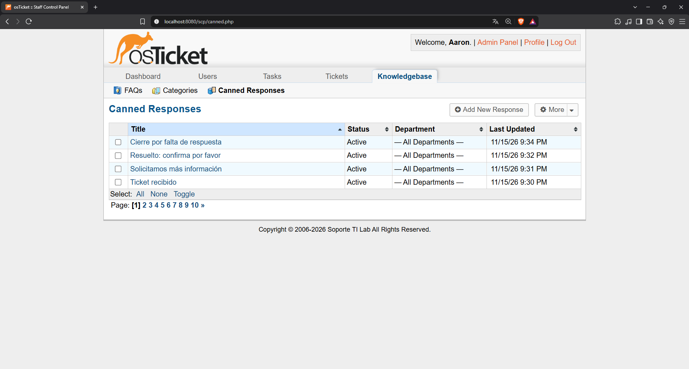

## 6. Agentes

Creé un segundo agente, Laura, con Redes como departamento principal y Soporte TI como acceso extendido (Admin Panel → Agents → Agents). Después también le di a Aaron acceso extendido a Redes, porque un agente solo ve los tickets de los departamentos a los que tiene acceso.

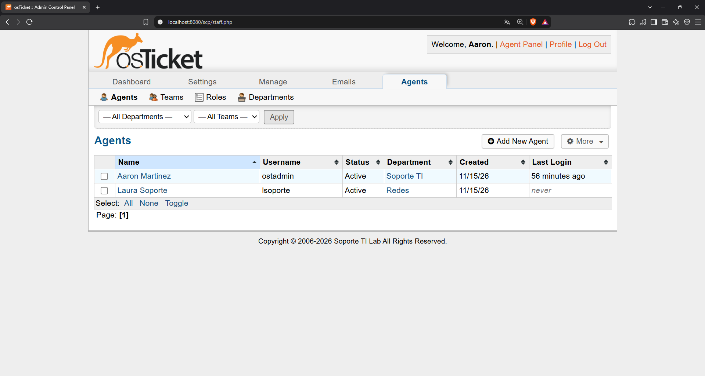

## 7. Tickets

Creé diez tickets desde New Ticket en el panel de agentes. Todos están escritos con la misma estructura:

```
Equipo: ...
Descripción: ...
Mensaje de error: ...
Desde cuándo: ...
Impacto: ...
```

En cada ticket hice los mismos pasos:
1. Lo abrí con el correo del usuario, elegí el tema de ayuda, el departamento, el SLA, la prioridad y a quién se asigna. La respuesta inicial es la plantilla *Ticket recibido*, y el triage va en una nota interna.
2. Escribí la causa y la solución en una nota interna.
3. Respondí con la plantilla *Resuelto: confirma por favor*.
4. El usuario confirma desde el portal (`http://localhost:8080/view.php`, con su correo y el número de ticket), haciéndome pasar por él.
5. Cerré el ticket con una nota interna.

Los usuarios son los mismos del laboratorio de Active Directory, con correos `@example.com`. La lista completa está en [`simulated-tickets.es.md`](simulated-tickets.es.md).

### Un ticket por área

**Soporte TI, cuenta bloqueada (#199835).**

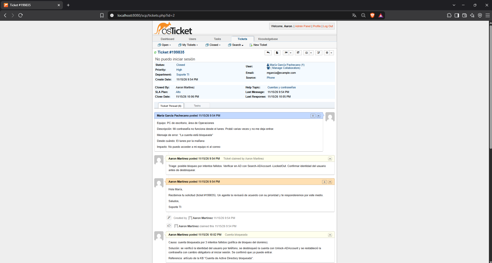
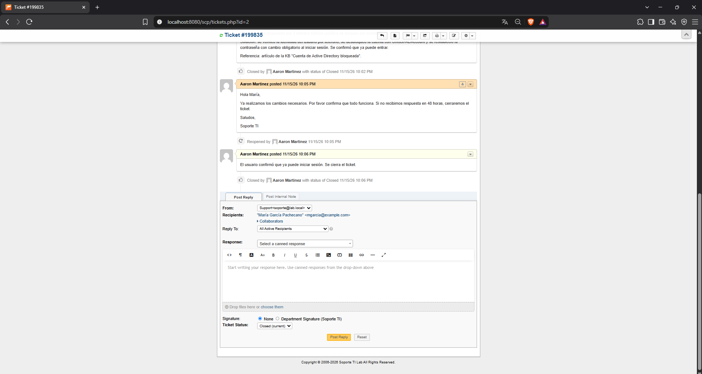

**Impresoras y periféricos, cola de impresión atascada (#799525).**

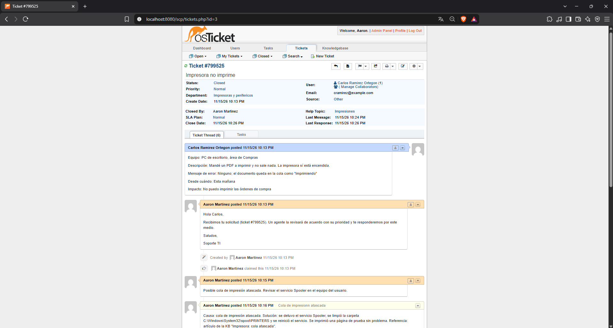
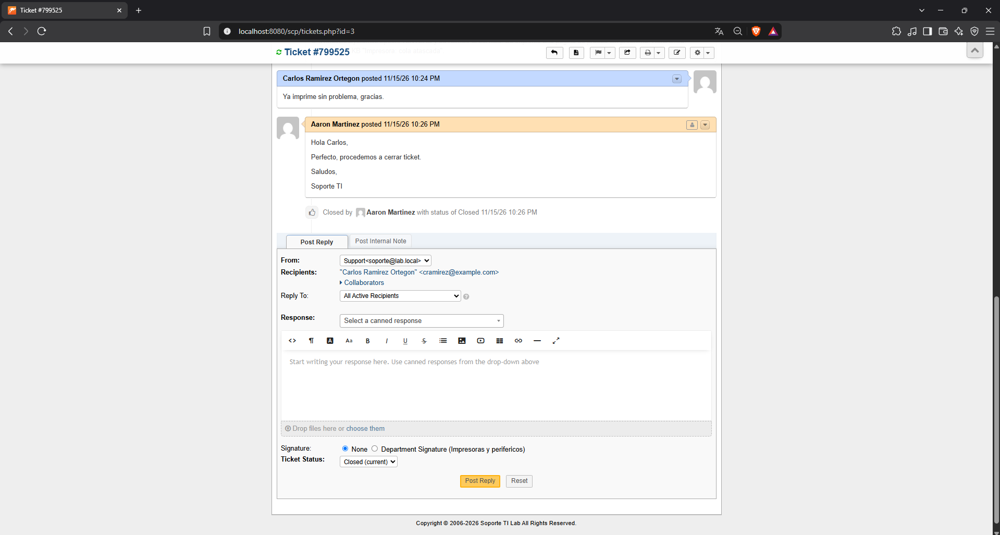

**Redes, sin internet, resuelto por Laura (#764102).**

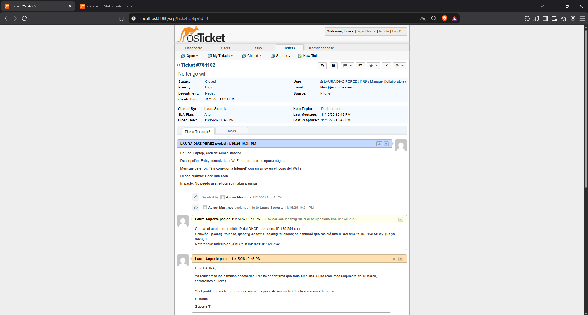
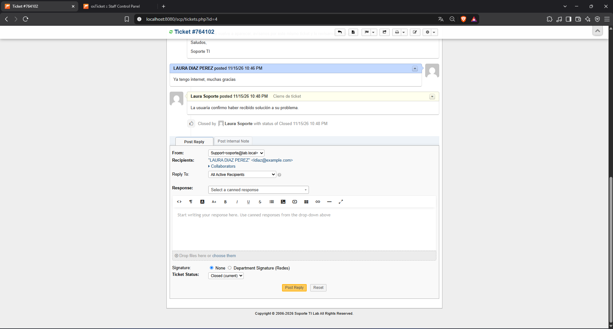

### Transferencia entre departamentos

El ticket #541839 ("No abre carpeta compartida") entró a Redes, pero el error era de permisos y no de red. Laura lo transfirió a Soporte TI con una nota y allí se resolvió (la usuaria no estaba en el grupo `GG_Compras`).

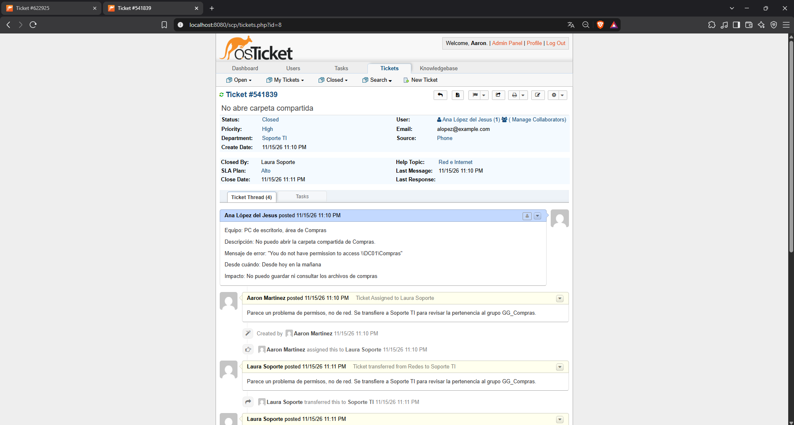
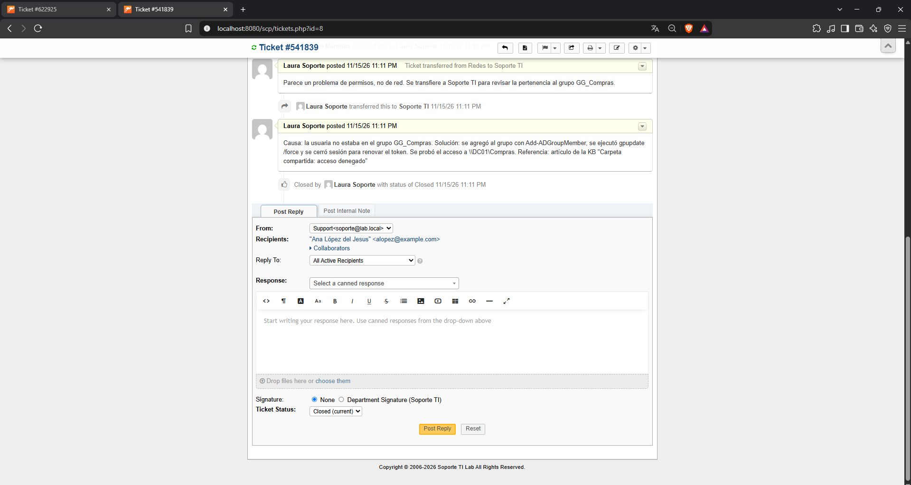

### SLA vencido

El ticket #622925 ("VPN no conecta") usa el plan Crítico y la prioridad Emergency. osTicket no me deja poner una fecha de vencimiento pasada, así que la puse unos minutos adelante, y la tarea programada de osTicket (corre cada 5 minutos) lo marcó como vencido.

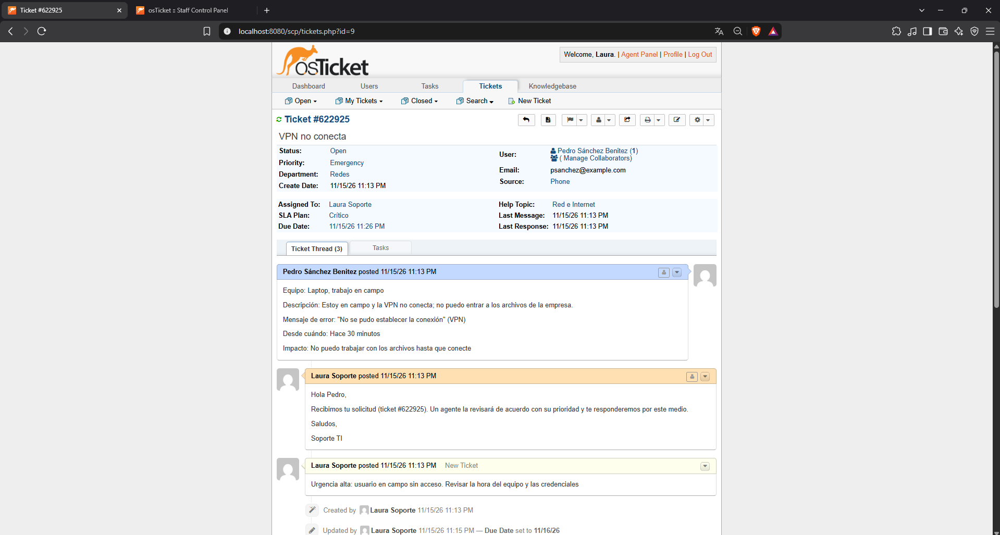
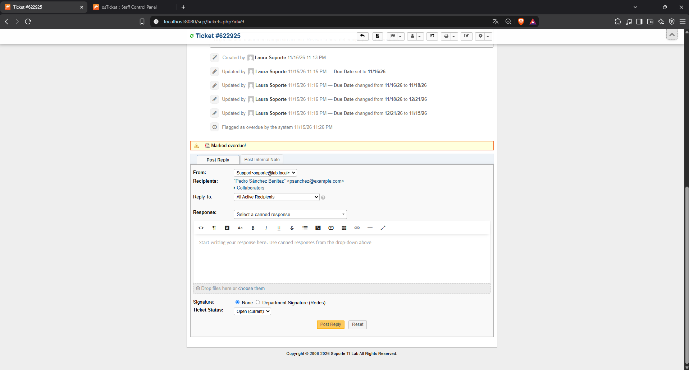

### Tickets cerrados

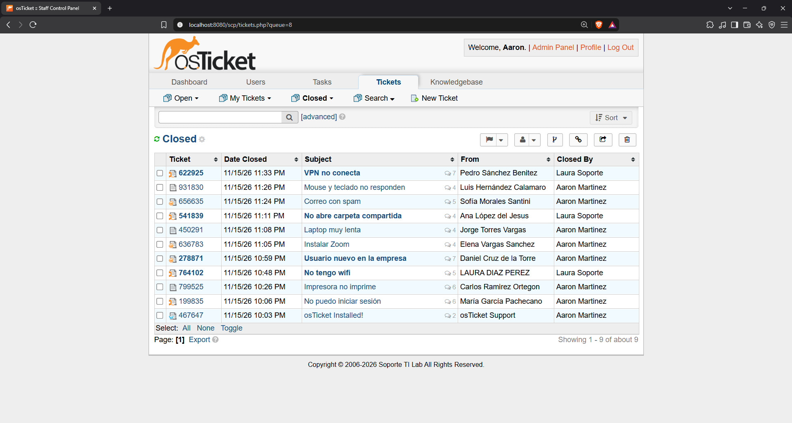

## 8. Base de conocimiento

En el Agent Panel → Knowledgebase creé una categoría pública, "Soporte TI", y cuatro artículos. Las soluciones de los tickets apuntan a ellos. Los textos están en [`kb/`](kb/).

- Cuenta de Active Directory bloqueada
- Impresora: cola atascada
- Sin internet: IP 169.254
- Carpeta compartida: acceso denegado

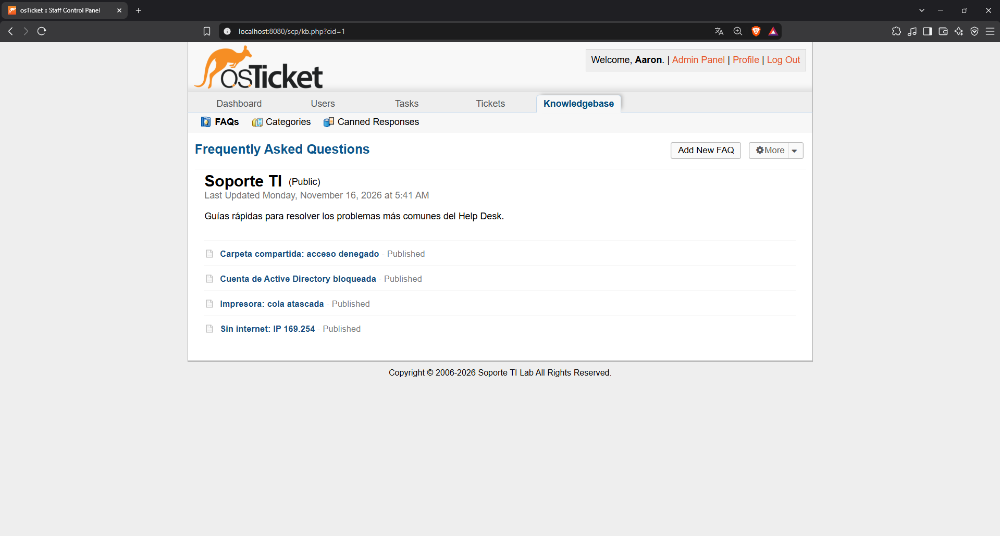
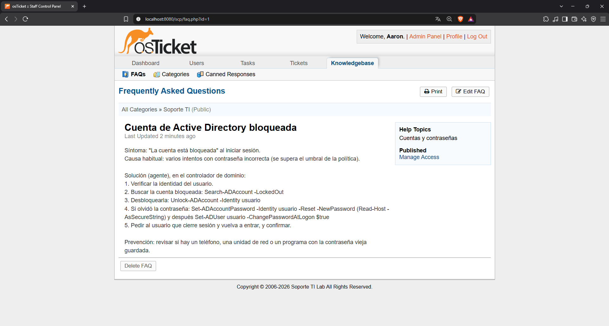

## Notas

- El lab no tiene servidor de correo, así que osTicket no puede mandar emails. Muestra errores al intentarlo, pero los tickets se crean igual.
- Para que los usuarios revisen un ticket sin un enlace por correo, desactivé "Require email verification on Check Ticket Status" en Settings → Users.
- osTicket no acepta correos `.local`. Usé `example.com`.
- osTicket muestra la hora en UTC, seis horas adelante de mi PC.
- El archivo `.env` no está en el repositorio.
